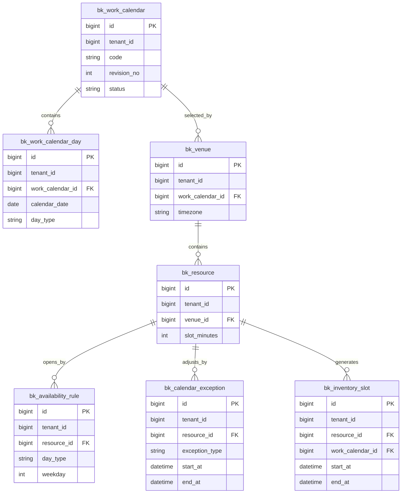
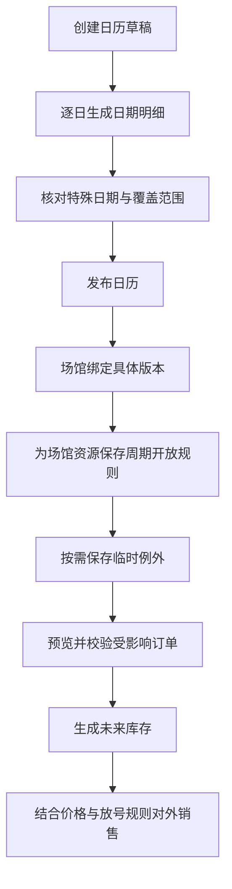
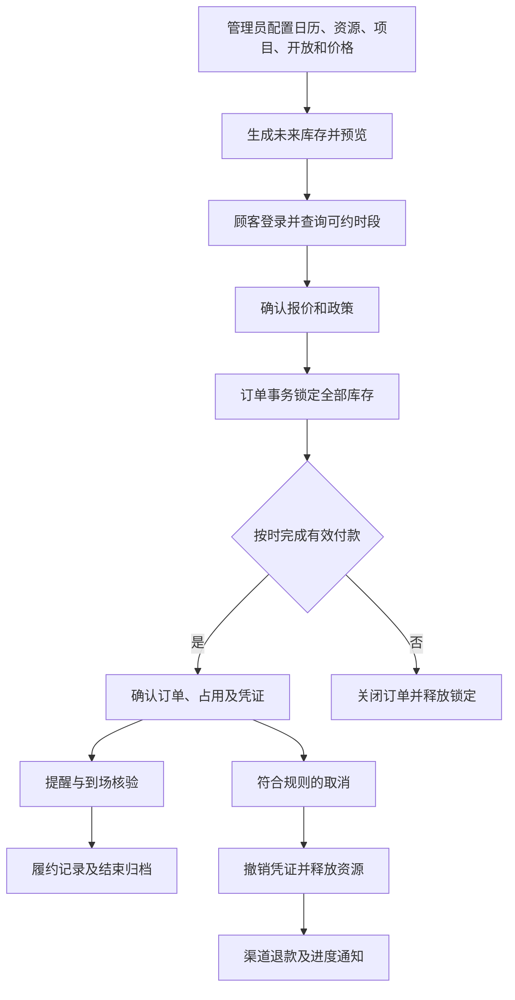

# 收费场馆预约产品：业务功能模块与职责划分

## 1. 产品范围

面向按具体场地、连续时段收费的场馆，例如羽毛球、网球及篮球包场。一个商家对应一个租户，可管理多个场馆；每个场馆有具体资源、预约项目、开放安排和价格方案。

首版订单限定同一场馆、一片主场地、连续时段。订单表保留多明细结构，部分取消、多场地组合等功能暂不开放。多人参与、共享人数库存、教练、设备、次卡及门禁属于后续扩展；存在相关字段不代表功能已实现。

本文是功能规格和开发分工依据，配套 SQL 是数据结构初始化文件；不包含页面、接口实现或真实支付渠道接入。

## 2. 使用端及角色

| 使用端 | 角色 | 责任与数据范围 |
|---|---|---|
| 平台管理端 | 平台运营 | 开通商家、套餐及基础支持；沿用租户模块，跨租户操作需显式授权与留痕 |
| 商家管理端 | 商家管理员 | 商家内全部场馆、员工授权、项目与经营配置、统计 |
| 商家管理端 | 场馆负责人 | 授权场馆的排期、订单、取消退款、现场异常 |
| 员工核销端 | 前台、核验员 | 授权场馆的当日安排、代订、收款登记、核验及履约 |
| 顾客小程序端 | 预约用户 | 登录、浏览、预约付款、本人订单、取消退款、资料和联系人 |
| 后台自动任务 | 系统执行器 | 库存生成、到期释放、支付核对、退款重试、通知、对账 |

后台账号与消费者账号分开；同一个人承担两种身份时也必须通过各自身份鉴权。核验员无需默认获得退款、调价和消费者全量资料权限。

## 3. 一级模块与数据归属

| 编号 | 业务模块 | 核心数据表 | 主要使用端 |
|---|---|---|---|
| M01 | 商家与权限基础 | 复用租户、账号、角色、场馆授权 | 平台、管理、员工 |
| M02 | 场馆与资源 | bk_venue、bk_resource_type、bk_resource | 管理 |
| M03 | 预约项目与政策 | bk_product、bk_product_resource、bk_booking_policy | 管理、小程序 |
| M04 | 工作日历与开放排期 | bk_work_calendar、bk_work_calendar_day、bk_availability_rule、bk_calendar_exception | 管理 |
| M05 | 定价与报价 | bk_price_plan、bk_price_rule | 管理、小程序、前台 |
| M06 | 库存与占用 | bk_inventory_slot、bk_resource_reservation | 各端通过业务接口使用 |
| M07 | 消费者与渠道登录 | bk_customer、bk_client_app、bk_customer_identity、bk_customer_contact | 管理、小程序 |
| M08 | 预约订单 | bk_order、bk_order_item、bk_order_item_segment；bk_order_participant 为扩展 | 各端 |
| M09 | 支付与退款 | bk_payment、bk_refund、bk_refund_item | 小程序、管理、前台 |
| M10 | 凭证与履约 | bk_credential、bk_fulfillment、bk_verification_log | 小程序、员工、管理 |
| M11 | 消息与自动任务 | bk_notification_task、bk_outbox_event | 系统、管理 |
| M12 | 审计、统计与对账 | bk_order_event 及上述业务表；复用操作日志 | 管理、系统 |

每个模块拥有自己的写入口。订单模块申请资源分配，不能绕过库存接口直接修改占用；核验模块不直接改支付事实；消费者资料变更不回写历史订单快照。

## 4. 商家管理端详细功能

### M01 商家与权限基础

| 功能 | 操作及规则 |
|---|---|
| 商家开通 | 复用已有租户创建、启停和账号机制，不重复建立商家主表 |
| 员工授权 | 分配管理员、负责人、前台及核验权限，限定可操作场馆 |
| 数据范围 | 订单、资源、消费者均限定 tenant_id；场馆负责人追加场馆范围 |
| 敏感操作授权 | 改价、退款、现金确认、人工结束履约单独授权并审计 |

若现有权限模块不能表达员工与场馆的关系，需补充授权关系；当前 31 表不替代角色权限系统。

### M02 场馆与资源

| 功能 | 操作及规则 |
|---|---|
| 场馆维护 | 名称、地址、时区、指引、联系方式、日历绑定、营业状态 |
| 资源类型 | 羽毛球场、网球场等类型；首版类别 SPACE |
| 具体场地 | 编号、类型、设施、建议人数、库存片粒度、启停与排序 |
| 生命周期 | 场馆暂停或资源停用后停止新售；已有订单需明确处理 |
| 配置约束 | 有未来库存或未结束预约时不能直接改变库存粒度、模式和资源类型 |

### M03 预约项目与政策

| 功能 | 操作及规则 |
|---|---|
| 项目配置 | 名称、主资源类型、说明、封面、可售资源列表 |
| 资源选择 | 只允许关联同租户同场馆且类型一致的场地；多个项目共用同一资源库存 |
| 预约限制 | 提前天数、放号时间、停止下单时间、最短与最长时长 |
| 付款规则 | 待付款期限、超时关闭策略 |
| 取消退款规则 | 取消截止、不同提前时间对应退款比例、整数金额舍入 |
| 到场规则 | 最早签到、最晚签到、是否人工结束、未到场策略 |
| 发布管理 | 政策发布后只读，新版本替换引用；成交保存原规则快照 |

### M04 工作日历与排期

#### M04.1 业务边界与功能清单

本章将业务场景、四张表的存取方式、场馆关联和完整数据样例集中说明。字段名称沿用当前 [数据模型](data-model.md)，不在本次文档调整中改变 SQL 结构。

当前模型要求 `bk_venue.work_calendar_id` 必填。仅按星期经营的场馆也绑定一份基础周历，开放规则使用 `WEEKDAY`；基础日期可按星期模板生成，不需要逐日人工设置。需要跟随特定假期或调休的场馆，再维护日期分类并使用 `WORKDAY`、`REST_DAY` 规则。此前讨论的“工作日历改成可选”属于另一种简化方案，尚未反映到当前字段设计，本章不混用两种口径。

工作日历记录日期分类。营业时间由开放规则和临时例外确定，价格由 M05 确定。例如某天为 `REST_DAY`，场馆仍然可以正常营业；将日期改成休息日不会自动生成整日停业。

| 功能 | 管理员操作 | 数据写入 | 结果 |
|---|---|---|---|
| 创建日历 | 设置名称、覆盖范围和默认休息星期 | `bk_work_calendar` 草稿 | 得到一份尚未生效的日期分类方案 |
| 生成日期 | 按默认星期模板逐日生成 | `bk_work_calendar_day` | 覆盖范围内每天一条分类记录 |
| 特殊日期维护 | 导入或手工调整假期、调休、经营休息日 | 草稿日历的日期明细 | 改变指定日期的分类，不直接改变某个时段 |
| 发布与绑定 | 校验日期完整性，发布后选择应用场馆 | 日历状态、`bk_venue.work_calendar_id` | 场馆资源统一使用确定的日历版本 |
| 周期开放 | 选择资源、日期条件、生效日期和营业时段 | `bk_availability_rule` | 长期重复使用的开放安排 |
| 临时调整 | 选择资源和具体开始、结束时间 | `bk_calendar_exception` | 临时加开、维修、整日关闭或内部占用 |
| 预览与生效 | 查看匹配规则、受影响订单和库存差异 | 发布操作及排期任务 | 重新计算受影响的未来可售时间 |
| 滚动维护 | 查看生成任务、日历覆盖和重算结果 | 自动生成 `bk_inventory_slot` | 持续提供未来可预约时间，保留已有占用 |

#### M04.2 场景如何落到四张表

| 业务场景 | 日历及日期明细 | 周期开放规则 | 临时例外 |
|---|---|---|---|
| 每周一至周五 09:00—22:00，周末 08:00—23:00 | 按默认周历生成即可 | 分别保存各星期的 `WEEKDAY` 规则 | 无需新增 |
| 跟随已维护的工作日、休息日安排营业 | 日期明细明确标记 `WORKDAY` 或 `REST_DAY` | 保存两类对应的开放区间 | 无需新增 |
| 某天有假期或调休，营业安排随分类变化 | 修改草稿日期分类，再发布新版本 | 已有分类规则继续复用 | 无需逐个资源新增例外 |
| 一个球场临时维修两小时 | 不改 | 不改 | 对该资源新增 `BLOCK` |
| 某天延长一小时营业 | 不改 | 不改 | 对该资源新增 `EXTRA_OPEN` |
| 整个场馆当天关闭 | 不改日期分类也可以实现 | 不改长期规则 | 将所选场馆资源逐个展开，分别新增覆盖整日的 `BLOCK` |
| 调整长期营业时间 | 不改日期分类 | 设置原规则终止日期，新增后续生效规则 | 不用大量临时例外模拟长期安排 |
| 只调整一家场馆的共享日历 | 复制日历及全部日期为新版本，修改后重新发布 | 按需沿用该场馆现有规则 | 不直接修改原共享版本 |

按星期配置中的“周一至周五”不会自动排除节假日；“周六、周日”也不会自动排除调休上班日。是否采用日期分类，由所配置的规则决定。节假日价格另在 M05 配置，新增加开记录不会自动产生价格。

#### M04.3 四张表和场馆的逻辑关系



图中的 FK 表示逻辑关联；当前交付的 MySQL 初始化脚本不建立物理外键，服务端仍须检查租户及引用关系。

- `bk_work_calendar` 属于租户，可被同一租户的多个场馆复用。
- `bk_work_calendar_day.work_calendar_id` 指向一个具体日历版本，每个版本独立保存全部日期。
- `bk_venue.work_calendar_id` 绑定具体版本，一个场馆在当前配置中选一份日历。
- `bk_resource.venue_id` 确定资源所属场馆。读取日历时沿资源找到场馆，无需在资源上重复绑定。
- `bk_availability_rule.resource_id` 和 `bk_calendar_exception.resource_id` 只作用于具体资源，不另存场馆 ID、日历 ID。
- 全馆或多资源操作由管理端批量展开为多条资源记录，不用 `resource_id=NULL` 表示整馆，也不向四张表临时增加不同层级的作用域字段。

场馆负责人通过授权场馆进入资源和规则管理。共享日历的发布由具有租户级日历权限的管理员执行；只有单馆权限时，可以发起复制并为授权场馆绑定新版本，不能修改其他场馆正在使用的版本。

#### M04.4 数据存储字段

四张表都包含下列公共字段。下方分别列出各自业务字段，公共字段不会因表中省略展示而缺失。

| 公共字段 | 类型 | 存储规则 |
|---|---|---|
| `id` | BIGINT | 每条记录独立主键，由 ID 生成器分配正数 |
| `tenant_id` | BIGINT | 从服务端租户上下文取得 |
| `create_user` | BIGINT | 创建人，系统操作可空 |
| `create_time` | UTC 时间 | 创建时间 |
| `update_user` | BIGINT | 最近修改人 |
| `update_time` | UTC 时间 | 最近修改时间 |
| `deleted` | BIGINT | `0` 未删除，当前记录自身 `id` 表示逻辑删除 |

**工作日历 `bk_work_calendar`**

| 字段 | 类型 | 如何写入和使用 |
|---|---|---|
| `code` | VARCHAR(64) | 同一逻辑日历的各版本使用同一编码 |
| `name` | VARCHAR(100) | 管理端可识别的日历名称 |
| `revision_no` | INT | 同编码业务版本，从 1 递增，不是公共乐观锁字段 |
| `region_code` | VARCHAR(32) | 可选地区信息，不凭该字段自动识别假期 |
| `coverage_from` | DATE | 覆盖首日，包含当日 |
| `coverage_to` | DATE | 覆盖末日，包含当日 |
| `default_rest_weekdays` | JSON | 如 `[6,7]`，以 1—7 表示周一至周日，仅用于初始化模板 |
| `status` | VARCHAR(20) | `DRAFT` 草稿、`PUBLISHED` 已发布、`RETIRED` 已退役 |
| `published_at` | UTC 时间 | 发布时写入 |
| `remark` | VARCHAR(500) | 来源或经营口径说明 |

唯一键为 `(tenant_id, code, revision_no)`。头表描述方案和版本，不存每天的日期分类，也不存营业时段。

**日历日期 `bk_work_calendar_day`**

| 字段 | 类型 | 如何写入和使用 |
|---|---|---|
| `work_calendar_id` | BIGINT | 所属日历版本 ID |
| `calendar_date` | DATE | 场馆使用的当地自然日期 |
| `day_type` | VARCHAR(20) | `WORKDAY` 工作日或 `REST_DAY` 休息日 |
| `is_holiday` | BOOLEAN | 是否标记为节假日，普通周末不必为 true |
| `is_adjusted` | BOOLEAN | 与默认星期模板比较，实际日期分类是否发生调整 |
| `holiday_name` | VARCHAR(100) | 可空，仅作展示，不直接参与开放规则匹配 |
| `source_type` | VARCHAR(30) | `WEEKLY_DEFAULT` 星期模板、`IMPORTED` 导入、`MANUAL` 人工设置 |
| `source_reference` | VARCHAR(300) | 可选的来源说明或导入批次 |
| `remark` | VARCHAR(300) | 调整原因 |

唯一键为 `(tenant_id, work_calendar_id, calendar_date)`。覆盖范围内的普通工作日也要保存，不能只存节假日；发布前检查每天恰好一条有效明细，且没有范围外日期。

**周期开放 `bk_availability_rule`**

| 字段 | 类型 | 如何写入和使用 |
|---|---|---|
| `resource_id` | BIGINT | 具体场地 ID |
| `effective_from` | DATE | 规则生效首日，包含当日 |
| `effective_to` | DATE | 生效末日，可空表示长期有效 |
| `day_type` | VARCHAR(20) | `WEEKDAY` 按星期、`WORKDAY` 工作日、`REST_DAY` 休息日 |
| `weekday` | SMALLINT | `WEEKDAY` 时必填 1—7；另外两类必须存 SQL NULL |
| `start_local_time` | 当地时间 | 单个营业区间的开始时间 |
| `end_local_time` | 当地时间 | 单个营业区间的结束时间 |
| `end_day_offset` | SMALLINT | `0` 当天结束、`1` 次日结束 |
| `status` | VARCHAR(20) | `ENABLED` 启用、`DISABLED` 停用 |

一条规则只存一个日期条件和一个营业区间。选择周一至周五会展开成五条，选择上午、下午两个区间再乘以两段；不将星期数组塞进 `weekday`。规则本身没有 `DRAFT`、`published_at` 或独立方案版本，保存前预览、保存后按生效期参与排期。

已有同资源、同日期条件、同生效范围和相同区间的有效规则时应拒绝重复写入。规则集编辑在锁定资源后事务执行，避免依赖包含可空 `weekday` 的普通唯一键。

**临时例外 `bk_calendar_exception`**

| 字段 | 类型 | 如何写入和使用 |
|---|---|---|
| `resource_id` | BIGINT | 受影响场地 ID |
| `exception_type` | VARCHAR(20) | `EXTRA_OPEN` 临时加开、`BLOCK` 临时停用 |
| `start_at` | UTC 时间 | 根据场馆时区换算的实际开始时间 |
| `end_at` | UTC 时间 | 实际结束时间，必须晚于开始时间 |
| `reason` | VARCHAR(300) | 必填，说明维修、加开或内部占用原因 |
| `status` | VARCHAR(20) | `ACTIVE` 生效、`REVOKED` 已撤销 |
| `approved_by` | BIGINT | 发生授权审批时记录审批人，否则可空；不代表默认存在多级审批流程 |

例外直接覆盖确定的时间区间，不需要填星期和日期分类。超过结束时间后可保留 `ACTIVE` 作为历史事实，读取时按区间过滤，不新增未定义的“已过期”枚举。撤销时改为 `REVOKED` 并记录操作原因，保留原始记录。

#### M04.5 完整数据存储样例

样例采用租户 `1001`、操作人 `9001`、时区 `Asia/Shanghai`，以 2026 年 10 月为覆盖范围。日期和调整均为经营场景假设，不表示法定节假日安排；ID 使用便于阅读的示例值，实际由生成器分配。

**第一步，创建日历草稿与整月日期**

头表存一条日历版本，日期表生成 31 条。SQL 使用 MySQL 8 语法，仅用于说明样例数据的写法，本次不连接数据库执行。

```sql
SET time_zone = '+00:00';
SET @tenant_id = 1001;
SET @operator_id = 9001;
SET @write_time = UTC_TIMESTAMP(3);

START TRANSACTION;

INSERT INTO bk_work_calendar (
    id, tenant_id, code, name, revision_no, region_code,
    coverage_from, coverage_to, default_rest_weekdays, status,
    published_at, remark, create_user, create_time, update_user, update_time, deleted
) VALUES (
    410001, @tenant_id, 'VENUE_CALENDAR', '场馆十月日历', 1, NULL,
    '2026-10-01', '2026-10-31', JSON_ARRAY(6, 7), 'DRAFT',
    NULL, '经营样例，未导入法定节假日',
    @operator_id, @write_time, @operator_id, @write_time, 0
);

INSERT INTO bk_work_calendar_day (
    id, tenant_id, work_calendar_id, calendar_date, day_type,
    is_holiday, is_adjusted, holiday_name, source_type, source_reference,
    remark, create_user, create_time, update_user, update_time, deleted
)
WITH RECURSIVE dates AS (
    SELECT DATE('2026-10-01') AS calendar_date
    UNION ALL
    SELECT DATE_ADD(calendar_date, INTERVAL 1 DAY)
    FROM dates WHERE calendar_date < '2026-10-31'
)
SELECT
    420000 + DAY(calendar_date), @tenant_id, 410001, calendar_date,
    CASE WHEN WEEKDAY(calendar_date) IN (5, 6) THEN 'REST_DAY' ELSE 'WORKDAY' END,
    FALSE, FALSE, NULL, 'WEEKLY_DEFAULT', NULL,
    NULL, @operator_id, @write_time, @operator_id, @write_time, 0
FROM dates;

UPDATE bk_work_calendar_day
SET day_type = 'REST_DAY', is_adjusted = TRUE, source_type = 'MANUAL',
    remark = '样例：周三安排经营休息日',
    update_user = @operator_id, update_time = @write_time
WHERE tenant_id = @tenant_id AND work_calendar_id = 410001
    AND calendar_date = '2026-10-21' AND deleted = 0;

UPDATE bk_work_calendar_day
SET day_type = 'WORKDAY', is_adjusted = TRUE, source_type = 'MANUAL',
    remark = '样例：周六按工作日安排经营',
    update_user = @operator_id, update_time = @write_time
WHERE tenant_id = @tenant_id AND work_calendar_id = 410001
    AND calendar_date = '2026-10-24' AND deleted = 0;

COMMIT;
```

生成后的部分日期数据如下，完整记录仍包括公共字段。

| id | work_calendar_id | calendar_date | 星期（计算展示） | day_type | is_holiday | is_adjusted | source_type |
|---|---|---|---|---|---|---|---|
| 420020 | 410001 | 2026-10-20 | 周二 | WORKDAY | false | false | WEEKLY_DEFAULT |
| 420021 | 410001 | 2026-10-21 | 周三 | REST_DAY | false | true | MANUAL |
| 420024 | 410001 | 2026-10-24 | 周六 | WORKDAY | false | true | MANUAL |
| 420025 | 410001 | 2026-10-25 | 周日 | REST_DAY | false | false | WEEKLY_DEFAULT |

`is_holiday=false` 与 `REST_DAY` 并不冲突，经营休息日可以不属于节假日。默认模板后续变化不直接重写已经发布的日期。

**第二步，发布日历并绑定场馆、资源**

服务端先校验覆盖日期完整、分类合法、没有越界日期及重复记录，再执行发布；必须检查状态更新成功。本例发布 SQL 额外校验范围内有效日期数量。

```sql
UPDATE bk_work_calendar AS c
SET c.status = 'PUBLISHED', c.published_at = @write_time,
    c.update_user = @operator_id, c.update_time = @write_time
WHERE c.id = 410001 AND c.tenant_id = @tenant_id
    AND c.status = 'DRAFT' AND c.deleted = 0
    AND (
        SELECT COUNT(*) FROM bk_work_calendar_day AS d
        WHERE d.tenant_id = c.tenant_id AND d.work_calendar_id = c.id
            AND d.deleted = 0
            AND d.calendar_date BETWEEN c.coverage_from AND c.coverage_to
    ) = DATEDIFF(c.coverage_to, c.coverage_from) + 1;

INSERT INTO bk_venue (
    id, tenant_id, code, name, timezone, work_calendar_id, address, status,
    create_user, create_time, update_user, update_time, deleted
) VALUES
    (430001, @tenant_id, 'SOUTH', '城南运动馆', 'Asia/Shanghai', 410001, '城南地址', 'OPEN',
     @operator_id, @write_time, @operator_id, @write_time, 0),
    (430002, @tenant_id, 'NORTH', '城北运动馆', 'Asia/Shanghai', 410001, '城北地址', 'OPEN',
     @operator_id, @write_time, @operator_id, @write_time, 0);

INSERT INTO bk_resource_type (
    id, tenant_id, code, name, category, status,
    create_user, create_time, update_user, update_time, deleted
) VALUES (
    440001, @tenant_id, 'BADMINTON', '羽毛球场', 'SPACE', 'ENABLED',
    @operator_id, @write_time, @operator_id, @write_time, 0
);

INSERT INTO bk_resource (
    id, tenant_id, venue_id, resource_type_id, code, name,
    inventory_mode, capacity, slot_minutes, status,
    create_user, create_time, update_user, update_time, deleted
) VALUES
    (450001, @tenant_id, 430001, 440001, 'COURT_1', '一号场',
     'EXCLUSIVE', 1, 30, 'ENABLED', @operator_id, @write_time, @operator_id, @write_time, 0),
    (450002, @tenant_id, 430001, 440001, 'COURT_2', '二号场',
     'EXCLUSIVE', 1, 30, 'ENABLED', @operator_id, @write_time, @operator_id, @write_time, 0);
```

两家场馆共享日期分类，营业区间并未因此共享。样例继续配置城南运动馆资源，城北运动馆需另行配置自己的资源开放规则。

**第三步，保存周期开放区间**

本例采用日期分类方式，工作日分上午、下午营业，休息日连续营业。两个资源各保存三条，共六条规则；规则长期有效，但日历和库存的可售覆盖仍有限。

```sql
INSERT INTO bk_availability_rule (
    id, tenant_id, resource_id, effective_from, effective_to, day_type, weekday,
    start_local_time, end_local_time, end_day_offset, status,
    create_user, create_time, update_user, update_time, deleted
) VALUES
    (460001, @tenant_id, 450001, '2026-10-01', NULL, 'WORKDAY', NULL,
     '09:00:00', '12:00:00', 0, 'ENABLED', @operator_id, @write_time, @operator_id, @write_time, 0),
    (460002, @tenant_id, 450001, '2026-10-01', NULL, 'WORKDAY', NULL,
     '14:00:00', '22:00:00', 0, 'ENABLED', @operator_id, @write_time, @operator_id, @write_time, 0),
    (460003, @tenant_id, 450001, '2026-10-01', NULL, 'REST_DAY', NULL,
     '08:00:00', '23:00:00', 0, 'ENABLED', @operator_id, @write_time, @operator_id, @write_time, 0),
    (460004, @tenant_id, 450002, '2026-10-01', NULL, 'WORKDAY', NULL,
     '09:00:00', '12:00:00', 0, 'ENABLED', @operator_id, @write_time, @operator_id, @write_time, 0),
    (460005, @tenant_id, 450002, '2026-10-01', NULL, 'WORKDAY', NULL,
     '14:00:00', '22:00:00', 0, 'ENABLED', @operator_id, @write_time, @operator_id, @write_time, 0),
    (460006, @tenant_id, 450002, '2026-10-01', NULL, 'REST_DAY', NULL,
     '08:00:00', '23:00:00', 0, 'ENABLED', @operator_id, @write_time, @operator_id, @write_time, 0);
```

如果改为固定周历方式，应为资源配置 `day_type=WEEKDAY`、`weekday=1…7` 的记录。不要一边保存完整工作日、休息日规则，一边期待星期规则继续叠加；分类规则命中后，当天星期规则只作为被覆盖的后备配置。

**第四步，保存临时维修与加开**

城南一号场在 10 月 20 日 14:00—16:00 维修，当晚额外开放 22:00—23:00，但 22:30—23:00 留作内部使用。当地时间统一换算为 UTC 存储。

| id | 例外类型 | 场馆当地时间 | UTC 存储区间 |
|---|---|---|---|
| 470001 | BLOCK | 10 月 20 日 14:00—16:00 | 10 月 20 日 06:00—08:00 |
| 470002 | EXTRA_OPEN | 10 月 20 日 22:00—23:00 | 10 月 20 日 14:00—15:00 |
| 470003 | BLOCK | 10 月 20 日 22:30—23:00 | 10 月 20 日 14:30—15:00 |

```sql
INSERT INTO bk_calendar_exception (
    id, tenant_id, resource_id, exception_type, start_at, end_at,
    reason, status, approved_by, create_user, create_time, update_user, update_time, deleted
) VALUES
    (470001, @tenant_id, 450001, 'BLOCK', '2026-10-20 06:00:00', '2026-10-20 08:00:00',
     '地板维修', 'ACTIVE', NULL, @operator_id, @write_time, @operator_id, @write_time, 0),
    (470002, @tenant_id, 450001, 'EXTRA_OPEN', '2026-10-20 14:00:00', '2026-10-20 15:00:00',
     '延长营业', 'ACTIVE', NULL, @operator_id, @write_time, @operator_id, @write_time, 0),
    (470003, @tenant_id, 450001, 'BLOCK', '2026-10-20 14:30:00', '2026-10-20 15:00:00',
     '内部活动', 'ACTIVE', NULL, @operator_id, @write_time, @operator_id, @write_time, 0);
```

写入前必须检查现有待付款锁定和已确认订单。上述样例假设区间内没有既有占用，因此可直接落为 `ACTIVE`；存在占用时不能照抄插入并覆盖订单，应先执行本章后面的影响处置流程。

#### M04.6 如何读取并得到最终开放时间

输入为租户、资源和目标当地日期。以租户 `1001`、资源 `450001`、日期 `2026-10-20` 为例：

1. 按资源找到场馆 `430001`，读取时区 `Asia/Shanghai` 和日历 `410001`。
2. 读取日历日期明细，得到当天为 `WORKDAY`；日历不存在、未发布、跨租户或缺少该日期时，本口径不允许该日新售。`RETIRED` 日历只允许原有合法绑定继续读取，不能新增绑定。
3. 查询当天有效的周期规则，要求 `deleted=0`、`status=ENABLED`、`effective_from<=目标日期`，且 `effective_to` 为空或不早于目标日期。
4. 有匹配的 `WORKDAY` 规则时，取其全部区间并集；没有才使用当天星期对应的 `WEEKDAY` 规则；没有任何匹配则基准区间为空。`REST_DAY` 同理。
5. 查询与目标日期相交的有效临时例外。当地日界线转换为 UTC 后，用 `start_at<查询结束 AND end_at>查询开始` 判断相交，不能直接比较 UTC 时间的 DATE 值与当地日期。
6. 最终开放区间为“周期开放区间并集，加上 EXTRA_OPEN，并扣除全部 BLOCK”。BLOCK 始终优先，新增的加开不能越过另一条有效停用。
7. 按当地零点对齐的 `slot_minutes` 生成或更新完整库存片，再交给 M05 报价和 M06 检查余量。开放不代表已经有价格，也不代表尚未售出。

样例结果如下，时间区间均为场馆当地左闭右开区间。

| 场地与日期 | 周期开放 | 临时调整 | 最终开放 |
|---|---|---|---|
| 一号场，10 月 20 日 | 09:00—12:00、14:00—22:00 | 加开 22:00—23:00；停用 14:00—16:00、22:30—23:00 | 09:00—12:00、16:00—22:30 |
| 二号场，10 月 20 日 | 09:00—12:00、14:00—22:00 | 无 | 09:00—12:00、14:00—22:00 |
| 一号场，10 月 21 日 | 日期被标记 REST_DAY，采用 08:00—23:00 | 无 | 08:00—23:00 |
| 一号场，10 月 24 日 | 日期被标记 WORKDAY，采用 09:00—12:00、14:00—22:00 | 无 | 09:00—12:00、14:00—22:00 |

一号场 10 月 20 日最终有 19 个 30 分钟开放库存片，二号场有 22 个。这只是开放候选数量，项目未发布、没有匹配价格或已有预占时，可销售数量还会减少。

本章样例不跨午夜。跨午夜星期规则需额外读取前一日有效规则；若目标日期已有日期分类规则，不得把前一日星期规则的尾段重新叠入。`WORKDAY`、`REST_DAY` 跨午夜时按数据模型要求在零点拆分，后半段重新按实际日期匹配。临时例外直接存完整 UTC 起止区间，可以跨午夜。

#### M04.7 管理操作的数据写入流程

**首次配置**



日期明细批量生成、同资源规则批量编辑和全馆例外批量保存分别在各自事务内完成。新配置不得在资源列表展开到一半时对外展示为已完整生效。

**长期规则调整**

例如从 11 月 1 日起缩短营业时间，应设置原规则 `effective_to=2026-10-31`，新增 `effective_from=2026-11-01` 的规则。修改后重新计算 11 月起的库存，并检查已售订单；已成交的资源时间和价格快照不回写。规则长期有效不代表永不变化，也不要求每周重建规则记录。

**临时加开、停用和撤销**

1. 校验租户、员工场馆授权、资源状态和时间边界，界面当地时间转换为 UTC。
2. 预览受影响库存、待付款预占及已确认订单。预览后提交时再次检查，不能把旧预览作为最终一致性依据。
3. 在受控事务中按固定资源和时间顺序锁定库存。无冲突时保存例外并同步可售状态；有冲突时不自动取消或清空占用。
4. 对已有订单协商履约、取消退款或按首版方式取消重订。当前例外表没有“待处理”状态，未解决的申请不能伪装成 ACTIVE 记录；若后续需要持久化审批工作台，应另设计申请模型。
5. 撤销例外时写 `status=REVOKED`、更新操作人和时间，再按全部剩余规则重新计算。撤销一条 BLOCK 不代表一定恢复可售，可能还有别的 BLOCK 或基础时间不开放。
6. 重算成功后恢复受影响新售并记录业务操作。大范围更新需先暂停受影响销售，避免规则和库存处于不同版本。

**共享日历单馆调整**

假设城南和城北都绑定 `410001`，只有城南需要调整 10 月 21 日：

| 步骤 | 写入位置 | 数据变化 |
|---|---|---|
| 复制草稿 | `bk_work_calendar` | 新建 `id=410002`、同 code、`revision_no=2`、`status=DRAFT` |
| 复制日期 | `bk_work_calendar_day` | 复制完整 31 天，每条分配新 id，`work_calendar_id=410002` |
| 修改日期 | 新版本日期明细 | 修改 10 月 21 日分类、来源、说明，并按默认模板重新计算 is_adjusted |
| 校验发布 | 新版本日历 | 检查完整性后置 PUBLISHED，填写 published_at |
| 影响预览 | 城南资源与订单 | 计算营业区间、价格和已有占用的变化 |
| 切换绑定 | `bk_venue` | 城南改为 410002，城北仍保留 410001 |
| 更新未来库存 | 城南的 `bk_inventory_slot` | 新排期使用新日历，已有成交分段保留旧日历快照 |

已发布日历及日期明细不原地修改。新版本不会因为 revision_no 更大而自动影响所有场馆；每个场馆显式切换。旧版本仍被城北或历史订单引用时保留，不删除、不自动退役。

#### M04.8 库存联动、维护与验收

四张配置表不存订单占用数量。`bk_inventory_slot` 保存具体可售时间片及锁定、已确认数量，`bk_resource_reservation` 保存业务占用明细。修改规则不允许用“先删除全部库存再生成”处理已有预约。

| 变化 | 需要处理的数据 | 既有预约保护 |
|---|---|---|
| 新增或修改周期规则 | 重算资源生效日期内未来库存 | 保留有效预占和已确认占用，无法履约时单独处置 |
| 新增或撤销例外 | 重算相交时段及可能跨日边界 | 不把撤销动作直接等同于释放或恢复订单 |
| 场馆切换日历 | 重算该场馆未来排期和报价 | 保留原成交政策、价格及仍有效的待付款锁定 |
| 未来日期逐步开放 | 滚动补齐完整库存片 | 幂等生成，不重复插入或覆盖已有计数 |
| 日历覆盖范围不足 | 提醒维护，复制扩展日历并发布切换 | 当前模型缺日期时停止该日新售，不取消已有订单 |

本章的“停止新售”是业务门禁要求，不是新增表字段。实现时需要受控资源销售门禁或同等机制，与排期事务、重算任务协调；不能假设仅提交四张配置表就已经完成对外可售状态更新。

最低验收要求：

1. 一份日历可被多场馆引用，单馆复制切换不影响其他场馆。
2. 覆盖范围内日期不缺失、不重复，草稿不被新绑定，已发布内容不可原地改写。
3. 按星期配置不会自动跟随调休；日期分类规则按明确维护的日期生效。
4. 一天多段营业正确保留中午休息，分类规则不会与后备星期规则错误合并。
5. 全馆操作展开为每资源记录，单资源维修不会影响其他资源。
6. 加开与停用重叠时停用优先，撤销一条停用后重新计算其他有效规则。
7. 当地时间与 UTC 转换正确，跨午夜查询不会漏例外或错误扩大区间。
8. 本章样例计算出一号场 19 个、二号场 22 个开放库存片。
9. 配置提交与并发下单相互校验，规则更新不超售、不静默丢失占用。
10. 临时加开还须通过 M05 价格覆盖和 M06 库存余量检查，不能无价销售。

### M05 定价与报价

| 功能 | 操作及规则 |
|---|---|
| 价格方案 | 场馆内维护多个版本化方案，由项目选择 |
| 日期定价 | 星期、工作日、休息日、指定日期 |
| 资源定价 | 场地专属价、资源类型价、方案默认价 |
| 分时定价 | 高低峰、跨日期按库存片分别报价 |
| 价格校验 | 同优先级不冲突、所有可售片有价、金额为整数最小单位 |
| 报价预览 | 展示各段价格、合计和命中规则；顾客确认后才下单 |

日期优先级为指定日期高于工作日/休息日，高于星期；同日期层级下专属场地高于资源类型，高于默认规则。开放与报价采用场馆同一工作日历。

### M08 预约订单与现场安排

| 功能 | 操作及规则 |
|---|---|
| 订单列表 | 按场馆、资源、使用时间、联系人、来源及状态筛选 |
| 订单详情 | 查看资源时段、成交分段、政策快照、支付退款、凭证及履约记录 |
| 场地日历 | 按资源展示已售、待付款锁定、停用和可售时段 |
| 代客预订 | 前台与后台遵循同一库存和报价规则；记录操作人 |
| 取消处置 | 顾客取消、场馆停业取消，分别保留原因和操作事实 |
| 异常处理 | 超时支付、临时停场、人工核实；首版改约按取消重订 |

### M09 支付与退款

| 功能 | 操作及规则 |
|---|---|
| 支付查询 | 本地支付单、渠道流水、金额与订单接纳结果 |
| 现场收款 | 授权员工登记现金或其他线下收款，不能把“收到截图”当线上支付成功 |
| 退款申请 | 按原规则计算，支持授权售后处理；额度先预留再请求渠道 |
| 退款跟踪 | 处理中、成功、失败；同次重试复用退款单号 |
| 异常付款 | 迟到或重复支付的资金事实保留，不能自动恢复已释放时段 |

支付账户、商户配置和密钥保管属于外部支付配置域；这套 SQL 不插入支付密钥，不假设项目已完成渠道接入。

### M12 统计与审计

| 指标或记录 | 口径 |
|---|---|
| 预订成交金额 | 有效接纳支付对应成交额，与创建订单金额区分 |
| 成功收款、退款与净收款 | 按资金成功时间统计，线下与线上渠道区分 |
| 资源预订利用率 | 已确认有效占用时长 / 实际可销售时长；停用时长从分母扣除 |
| 到场率、未到场率 | 根据履约和核验结果，不按订单时间结束假定到场 |
| 实际使用时长 | 仅使用可确认的实际开始/结束数据；不足时不伪造 |
| 异常看板 | 超时锁定、库存账不符、异常付款、退款失败、消息失败 |
| 操作与业务审计 | 区分接口操作日志与业务状态事件；支持按订单追溯 |

首版直接聚合业务数据，暂不增加报表事实表；数据量增长后再建设日汇总和报表模型。

## 5. 顾客小程序端详细功能

| 编号 | 页面/功能 | 用户动作与规则 | 主要数据 |
|---|---|---|---|
| C01 | 登录与账号 | 服务端核实渠道身份，建立消费者会话；手机号单独授权或核验 | customer、identity、client_app |
| C02 | 场馆列表与详情 | 浏览场馆、资源、营业说明和到场指引 | venue、resource |
| C03 | 项目与可约日历 | 选择项目、日期、场地，查看可售时间和价格 | product、inventory_slot、price_rule |
| C04 | 订单确认 | 选择连续时段、联系人，确认原价与取消规则 | customer_contact、policy、报价结果 |
| C05 | 下单付款 | 原子锁定全部库存，倒计时付款，重复请求幂等 | order、item、segment、reservation、payment |
| C06 | 我的预约 | 待付款、待使用、使用中、已结束、已取消；退款单独展示 | order、item、fulfillment |
| C07 | 预约详情与凭证 | 展示订单、时间、场地、二维码、指引和退款情况 | credential、payment、refund |
| C08 | 取消退款 | 服务端按成交规则与履约状态判断，展示实际退款额 | order、reservation、refund |
| C09 | 个人资料 | 修改自己的昵称、头像、联系电话 | customer |
| C10 | 常用联系人 | 增删改、默认联系人；修改不回写历史订单 | customer_contact |
| C11 | 提醒与进度 | 在已授权渠道接收成功、临近使用、取消及退款通知 | notification_task |

订单归属使用会话中的 tenant_id、customer_id 验证；不能以订单号、手机号或客户端提交的 customer_id 授权。前台未归属账号的代订单不按手机号自动认领。首版订单归预订人管理，常用联系人不自动获得查看或取消权限。

## 6. 前台与核销端详细功能

| 编号 | 功能 | 核心规则 |
|---|---|---|
| S01 | 员工身份与场馆选择 | 后台员工会话，校验可操作场馆和动作 |
| S02 | 今日场地安排 | 当前待到场、使用中、即将结束和停用情况 |
| S03 | 扫码查验 | 校验凭证、订单、场馆、时间、撤销状态；给出明确结果 |
| S04 | 人工查询 | 按授权条件查询订单，展示必要信息 |
| S05 | 签到 | 幂等记录有效到场；提前签到不产生提前使用权 |
| S06 | 开始与结束使用 | 有权限时记录实际动作，时间到期归档必须注明依据 |
| S07 | 现场订场与收款 | 使用统一库存、订单和资金流程；线下收款记录操作人 |
| S08 | 现场异常 | 错场馆、太早、过期、重复签到、订单取消分别提示；特殊处理留痕 |

首版每条明细一份有效凭证，服务按场地核验，不逐个核验球队成员。续时重新检查后续时段并新下单，不能直接延长原结束时间。

## 7. 后台自动任务与一致性

| 任务 | 执行内容 | 重试与失败处理 |
|---|---|---|
| 库存滚动生成 | 按开放规则和有效日历补齐未来库存 | 唯一网格＋资源时间唯一键，保留现有占用 |
| 配置重算 | 日历、开放或停用变化后更新未来可售安排 | 暂停受影响新售，保护待付款和已售权益 |
| 放号 | 到达放号时间后开放查询与下单资格 | 已生成不等于已放号，服务端实时校验 |
| 超时关闭 | 关闭未付款订单，原子释放预占 | 与支付确认竞争同一订单行，重复执行无副作用 |
| 支付核对 | 主动查单，补偿丢失通知，处理异常付款 | 验账户、金额和流水；不依赖前端结果 |
| 退款重试 | 根据稳定退款单号重试或查询渠道 | 失败不擅自释放资金预留，防止重复超退 |
| 到期归档 | 未到场标记，已签到权益归档 | 不虚构实际到场或实际使用时间 |
| 通知发送 | 消息去重、提醒、取消、退款结果 | 发送前核实订单状态，失败不回滚业务 |
| Outbox 投递 | 可靠投递业务事件 | 处理租约、重试、死信，消费者幂等 |
| 对账巡检 | 库存与预占、订单与资金一致性检查 | 标记待处理、必要时冻结新售，审计后修复 |
| 日历覆盖提醒 | 提示维护将到期的日期范围 | 缺日期不猜测，不影响已有订单事实 |

后台任务使用受控租户上下文，不能因批量任务关闭租户隔离后复用普通用户查询接口。

## 8. 跨模块主要流程



订单、占用和本地业务事件使用本地事务；渠道支付、退款、短信等外部操作通过幂等业务编号和可靠事件补偿，不能要求外部系统参与同一数据库事务。

## 9. 首版与后续功能边界

| 阶段 | 交付内容 |
|---|---|
| P0 基础闭环 | 商家隔离、场馆资源、预约项目、日历调休、开放与定价、消费者登录、原子预占、支付确认、取消退款、凭证核验、自动任务和审计 |
| P1 运营完善 | 常用联系人、排期影响预览、资金与库存异常工作台、经营统计和导出 |
| P2 场景扩展 | 一单多场地、部分取消、教练组合、人数容量、参与人核验、会员次卡、门禁与分账 |

SQL 包含 31 张表，覆盖 P0/P1 数据基础并预留订单参与人。P2 要增加业务服务、必要的表及一致性规则，不因已有枚举就自动支持。

## 10. 验收清单

1. 同一场地多个项目共用库存；并发预订只有一个成功。
2. 连续多个库存片全部占用成功才下单，任一片失败整单回滚。
3. 首次登录、下单、支付通知、退款和核验均能安全重试。
4. 工作日、普通周末、调休工作日、假期分类与开放、价格结果一致。
5. 调价或日历切换不改变历史金额、取消规则和仍有效的锁定权益。
6. 取消、支付超时和签到并发不产生重复销售或非法履约。
7. 用户只能管理自己的订单；员工只能操作授权场馆。
8. 退款总额不超过原成功支付，失败重试不重复占用或退还资金。
9. 时间到期不伪造实际使用；未到场单独记录。
10. 每个异常均可追溯到订单、资源、支付退款或操作事件。
