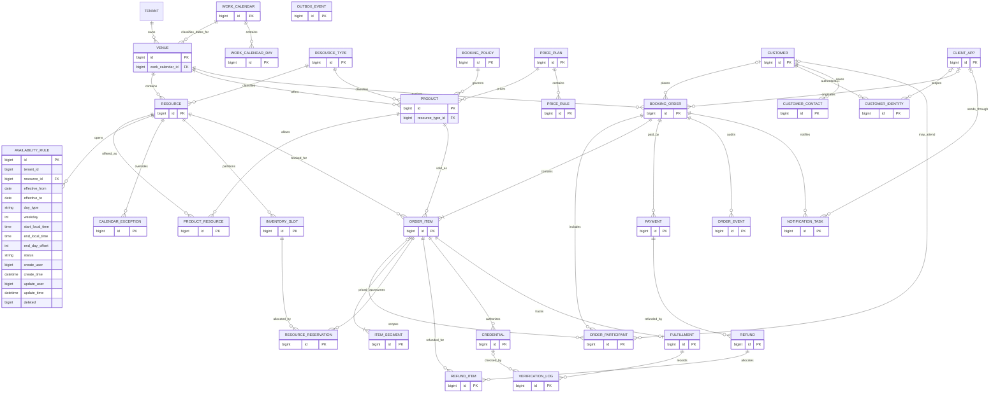
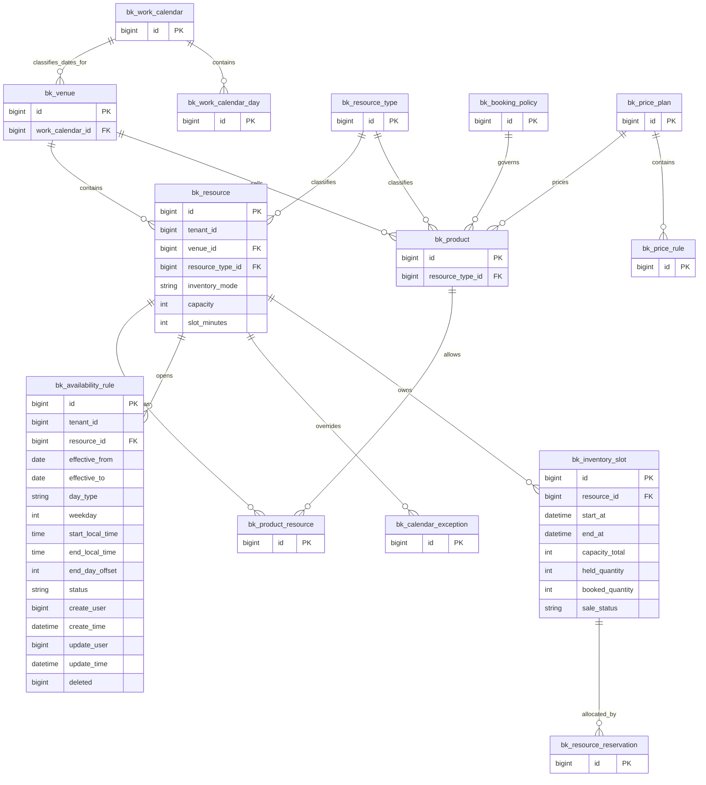
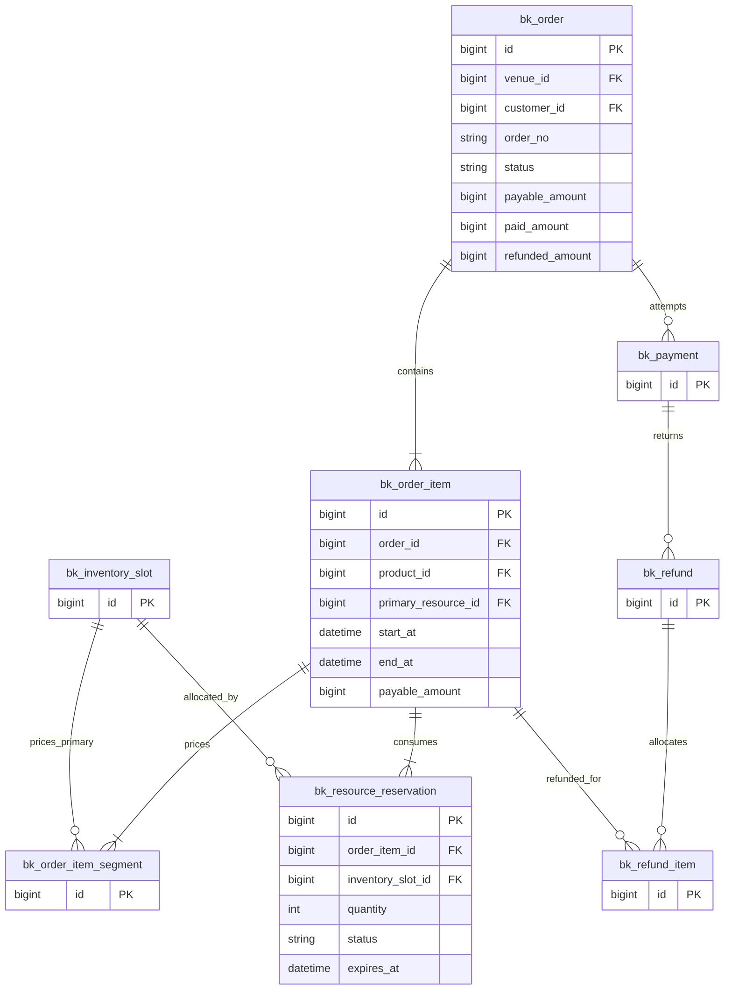
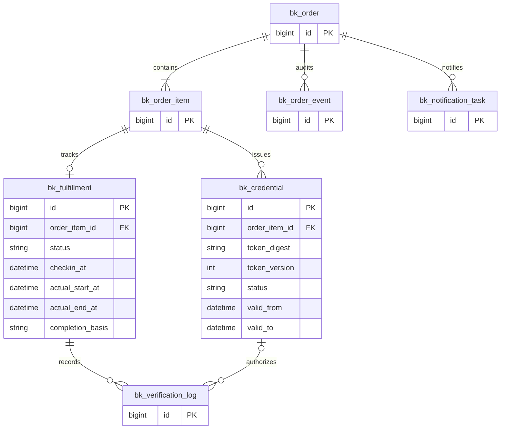
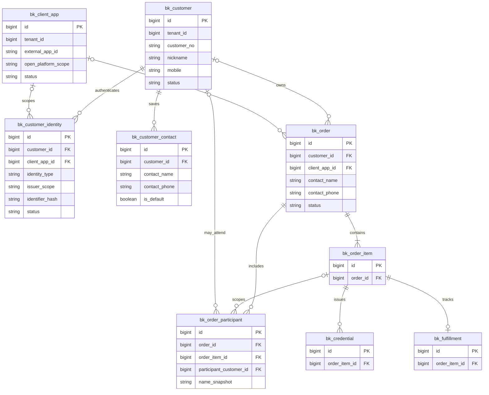
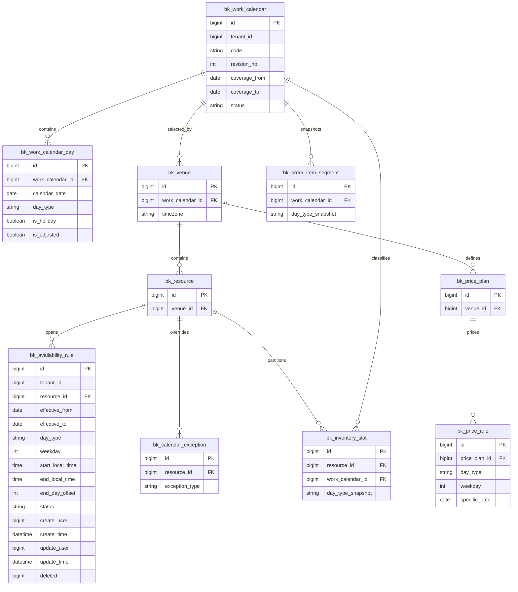

# 收费场馆预约 SaaS 数据模型设计（评审稿 v1）

## 1. 设计边界与约定

本方案面向收费场馆、运动空间的标准预约产品。首版支持一个商家管理多个场馆，顾客预订一片具体场地的连续时段，在线支付，现场核验，按规则取消退款。

业务示例：用户预订城南羽毛球馆 2 号场，2026-10-20 19:00—21:00；系统锁定两个小时的库存，付款成功后确认预约，到场后核验使用资格。

### 1.1 首版约束

- 一个租户视为一个独立商家；多品牌先通过场馆归属管理，不在首版增加结算主体层级。
- 一个订单只属于一个场馆、一个币种，首版只有一条预约明细；表结构允许后续增加多明细。
- 每条明细对应一个预约项目、一片销售场地、一个连续使用区间。
- 首版销售场地为独占资源，每个库存片容量为 1。
- 不同项目共用同一片场地时，必须共用该场地库存，不能按项目各建一份库存。
- 首版取消按整单处理；多明细、部分退款的结构可以预留，部分取消入口暂不开放。
- 首版不支持直接改约，取消重订；资源联动改约作为后续能力。
- 到场签到不等于服务完成；时间到期也不证明用户实际到场。

### 1.2 三个核心事实

1. 订单及明细记录用户购买的时段权益、金额和规则。
2. 库存片及资源预占记录资源在什么时间被什么业务占用。
3. 支付、退款、核验及履约记录资金和实际使用事实。

这些对象分别管理状态，通过事务和业务事件保持一致。

### 1.3 表名和字段类型

表名前缀暂用 `bk_`，实施时可按仓库约定统一调整。本文为逻辑设计，不是已经执行的数据库迁移。

| 标记 | 含义 |
|---|---|
| 必填 | 非空，或按所列业务条件必填 |
| 可空 | 允许尚未发生、尚未配置或该场景不适用 |
| BIGINT | 64 位整数；业务主键采用项目现有 ID 生成能力 |
| MONEY | BIGINT，金额最小单位；CNY 为分，禁止浮点金额 |
| UTC_TIME | UTC 毫秒时间；MySQL 可用 DATETIME(3)，PostgreSQL 可用 TIMESTAMP(3) WITH TIME ZONE；由迁移分别定义 |
| LOCAL_TIME | 场馆当地时分秒，不带日期 |
| JSON | 结构化快照或补充信息；MySQL JSON、PostgreSQL JSONB |

时间段一律使用左闭右开区间 `[start_at, end_at)`，19:00—20:00 和 20:00—21:00 不冲突。营业、节假日及展示以场馆时区解释，再转换为 UTC。跨午夜规则增加结束日偏移。

金额均为非负整数，折扣用“优惠金额”表达；发生退款不修改原成交金额。

### 1.4 公共字段

以下字段由各表继承。每张表的字段字典均显式列出 id 主键，其余公共字段不重复列出。数据库字段统一采用下划线命名，公共审计字段为 `create_user`、`create_time`、`update_user`、`update_time`、`deleted`；对应 Java 属性为 `createUser`、`createTime`、`updateUser`、`updateTime`、`deleted`。

| 字段 | 类型 | 必填/默认 | 说明 |
|---|---|---|---|
| id | BIGINT | 必填 | 每张表唯一的主键，统一使用 PRIMARY KEY (id)；由项目现有 ID 生成能力分配，值不为 0 |
| tenant_id | BIGINT | 必填 | 商家租户 ID，引用现有租户体系 |
| create_user | BIGINT | 可空 | 创建人账号 ID；系统操作可空，通过业务事件中的 actor_type 说明来源 |
| create_time | UTC_TIME | 必填 | 创建时间 |
| update_user | BIGINT | 可空 | 最近更新人账号 ID；创建时初始化为 create_user，系统操作可空 |
| update_time | UTC_TIME | 必填 | 最近更新时间；创建时初始化为 create_time，只追加记录保持初始值 |
| deleted | BIGINT | 必填/0 | 是否已删除（0：否；id：是），删除时写入当前记录自身的主键 id；不用于表达取消、停用或退款 |

配置数据使用 `status` 下架或归档；无业务引用且允许删除的配置可通过 `deleted=id` 逻辑删除，其中 id 为当前记录自身的主键。有效记录查询使用 `deleted=0`。订单、占用、支付、退款、核验、履约及事件记录保留公共字段，但不开放业务删除，`deleted` 保持 0。主键不使用 0，以免与未删除标识冲突。只追加记录不通过修改公共字段改写历史事实。本文既有业务唯一键仍保留原编码不复用；如后续允许配置编码在删除后复用，应将 `deleted` 纳入对应业务唯一键，并同步评审恢复记录时的冲突处理。

所有表（包括关联表、明细表、日志表和事件表）均使用独立的 `id` 作为唯一主键，不使用复合主键。各表字段字典均显式列出 id 并定义 `PRIMARY KEY (id)`。ER 图中每个本方案业务实体均显式标记 `bigint id PK`；其他字段仅在部分实体展开。

业务复合唯一键用于业务去重，不替代 id 主键。例如 `bk_product_resource` 具有自己的 id 主键，同时使用 `(tenant_id, product_id, resource_id)` 唯一键限制重复关联。

所有租户内关联必须同时校验 tenant_id；涉及场馆的关联还应校验 venue_id。支持时可额外建立 `(tenant_id, id)` 复合唯一键与对应复合外键，用于约束租户内引用，但不改变 `PRIMARY KEY (id)`。外部系统或项目未使用物理外键的关联由应用校验和一致性巡检保证。不能只依赖前端传入的租户、场馆或价格。

### 1.5 复用现有平台的数据

本方案不重复创建租户、后台用户、角色、组织、文件和通用审计体系。消费者账号独立建模，详见第 19 节；若实施时发现已有等价模块，可按该节的业务契约复用。

- `operator_user_id` 等后台操作人引用现有后台账号。
- `customer_id` 引用 `bk_customer.id`，表示商家租户内的消费者账号，不等于后台系统用户。
- 小程序 OpenID 等渠道身份属于消费者账号域，不直接存入预约订单。
- 场馆负责人、核验员授权可通过现有权限体系加场馆数据范围实现；若现有系统不能表达，再新增用户与场馆授权关系。
- 商家支付渠道、商户号和结算账户复用或单独建设支付配置域；本方案的 payment_account_id 为其引用，不保存密钥。

## 2. 模型清单

| 领域 | 数据表 | 首版定位 |
|---|---|---|
| 基础资源 | bk_venue、bk_resource_type、bk_resource | 核心 |
| 商品与规则 | bk_product、bk_product_resource、bk_booking_policy | 核心 |
| 日历排期 | bk_availability_rule、bk_calendar_exception、bk_work_calendar、bk_work_calendar_day | 核心；支持星期、工作日、休息日与调休 |
| 定价 | bk_price_plan、bk_price_rule | 核心 |
| 库存 | bk_inventory_slot、bk_resource_reservation | 核心 |
| 交易 | bk_order、bk_order_item、bk_order_item_segment | 核心 |
| 资金 | bk_payment、bk_refund、bk_refund_item | 核心 |
| 凭证与履约 | bk_credential、bk_fulfillment、bk_verification_log | 核心 |
| 可靠执行 | bk_order_event、bk_outbox_event | 核心支撑；可复用同等基础能力 |
| 通知 | bk_notification_task | 可复用平台通知能力 |
| 消费者与登录 | bk_customer、bk_client_app、bk_customer_identity | 小程序及用户中心核心 |
| 用户常用资料 | bk_customer_contact | 常用联系人，可按产品需要启用 |
| 实际参与人 | bk_order_participant | 多人、代约及分人核验扩展；首版可暂不启用 |

合计 31 张逻辑表，其中通知、事件等基础设施可复用，实际参与人模型可后续启用。数量用于说明业务责任，不代表首版必须自行实现 31 个独立模块。每张表均显式列出唯一 id 主键。

## 3. 总体 ER 图

图中租户、后台账号、支付账户是外部域引用，省略其完整字段；CUSTOMER 对应本方案 bk_customer。实线关系为目标数据关联，不代表必须全部建立物理外键。



## 4. 基础资源字段

### 4.1 场馆 bk_venue

| 字段 | 类型 | 必填/默认 | 说明 |
|---|---|---|---|
| id | BIGINT | 必填 | 唯一主键，PRIMARY KEY (id)，由 ID 生成器分配且不为 0 |
| code | VARCHAR(64) | 必填 | 租户内唯一场馆编码 |
| name | VARCHAR(100) | 必填 | 场馆名称 |
| timezone | VARCHAR(64) | 必填/Asia/Shanghai | IANA 时区名称 |
| work_calendar_id | BIGINT | 必填 | 日期分类日历，关联 bk_work_calendar.id；开放与定价统一使用该日历，详见第 20 节 |
| address | VARCHAR(300) | 必填 | 地址 |
| longitude | DECIMAL(11,7) | 可空 | 经度 |
| latitude | DECIMAL(10,7) | 可空 | 纬度 |
| contact_phone | VARCHAR(32) | 可空 | 对外联系电话 |
| cover_file_id | BIGINT | 可空 | 文件域引用 |
| arrival_guide | TEXT | 可空 | 交通、停车、到场说明 |
| status | VARCHAR(20) | 必填/DRAFT | DRAFT：草稿；OPEN：营业中；SUSPENDED：暂停营业；ARCHIVED：已归档 |
| sort_order | INT | 必填/0 | 展示顺序 |

唯一键 `(tenant_id, code)`。场馆停业不自动取消历史预约，已有订单进入明确处置流程。

### 4.2 资源类型 bk_resource_type

| 字段 | 类型 | 必填/默认 | 说明 |
|---|---|---|---|
| id | BIGINT | 必填 | 唯一主键，PRIMARY KEY (id)，由 ID 生成器分配且不为 0 |
| code | VARCHAR(64) | 必填 | 如 BADMINTON_COURT |
| name | VARCHAR(64) | 必填 | 如羽毛球场 |
| category | VARCHAR(20) | 必填/SPACE | SPACE：场地或空间；EQUIPMENT：设备或器材；STAFF：人员；首版仅支持 SPACE（场地或空间） |
| attribute_schema | JSON | 可空 | 补充属性定义，如室内外、地板材质；不承载库存规则 |
| status | VARCHAR(20) | 必填/ENABLED | ENABLED：启用；DISABLED：停用 |

唯一键 `(tenant_id, code)`。资源类型用于分类，不能代替具体资源库存。

### 4.3 具体资源 bk_resource

| 字段 | 类型 | 必填/默认 | 说明 |
|---|---|---|---|
| id | BIGINT | 必填 | 唯一主键，PRIMARY KEY (id)，由 ID 生成器分配且不为 0 |
| venue_id | BIGINT | 必填 | 所属场馆 |
| resource_type_id | BIGINT | 必填 | 资源类型 |
| code | VARCHAR(64) | 必填 | 场馆内唯一编号 |
| name | VARCHAR(100) | 必填 | 如羽毛球 2 号场 |
| inventory_mode | VARCHAR(20) | 必填/EXCLUSIVE | EXCLUSIVE：独占模式，同一时段仅允许一笔有效预约占用；SHARED：共享容量模式，同一时段可由多笔预约按数量共享容量；首版仅支持 EXCLUSIVE（独占模式），SHARED 为后续扩展 |
| capacity | INT | 必填/1 | 可售库存容量；独占模式固定为 1 |
| suggested_people | INT | 可空 | 建议使用人数，与库存容量含义不同 |
| slot_minutes | SMALLINT | 必填/30 | 底层库存片粒度；首版只支持明确允许的粒度 |
| attributes | JSON | 可空 | 补充展示属性 |
| cover_file_id | BIGINT | 可空 | 图片 |
| description | TEXT | 可空 | 设施介绍 |
| status | VARCHAR(20) | 必填/ENABLED | ENABLED：启用；DISABLED：停用；ARCHIVED：已归档 |
| sort_order | INT | 必填/0 | 排序 |

唯一键 `(tenant_id, venue_id, code)`。库存时间片按场馆当地日期的零点起算，以 slot_minutes 为固定粒度划分，不另设锚定日期字段。存在未来库存或未结束预约时禁止修改库存粒度和库存模式，需停约后迁移。首版同场馆统一粒度，避免多资源组合时对齐困难。

## 5. 商品、预约政策与资源关联

### 5.1 预约项目 bk_product

“项目”是用户购买入口，例如羽毛球散场预订；“资源”是实际占用的某片场地。一个预约项目对应一种主资源类型，通过项目可售资源关联选择该类型下的具体场地。同一资源可以支持多个项目并共享库存。

| 字段 | 类型 | 必填/默认 | 说明 |
|---|---|---|---|
| id | BIGINT | 必填 | 唯一主键，PRIMARY KEY (id)，由 ID 生成器分配且不为 0 |
| venue_id | BIGINT | 必填 | 所属场馆 |
| code | VARCHAR(64) | 必填 | 场馆内项目编码 |
| resource_type_id | BIGINT | 必填 | 主预约资源类型，关联 bk_resource_type.id，用于项目分类、资源筛选及类型一致性校验 |
| name | VARCHAR(100) | 必填 | 展示名称 |
| booking_policy_id | BIGINT | 必填 | 预约政策 |
| price_plan_id | BIGINT | 必填 | 价格方案 |
| pricing_mode | VARCHAR(20) | 必填/PER_SLOT | 首版按固定库存片定价 |
| description | TEXT | 可空 | 使用说明 |
| cover_file_id | BIGINT | 可空 | 展示图片 |
| status | VARCHAR(20) | 必填/DRAFT | DRAFT：草稿；PUBLISHED：已发布；OFFLINE：已下架；ARCHIVED：已归档 |
| sort_order | INT | 必填/0 | 排序 |

唯一键 `(tenant_id, venue_id, code)`。首版可按场馆内的主资源类型自动创建默认项目，例如羽毛球场预订、网球场预订。项目已有可售资源关联或历史订单后，不允许直接切换 resource_type_id，需要新建项目。后续组合预约仍由该字段标识主销售资源类型，教练、设备等辅助资源通过资源需求模型定义。

### 5.2 项目可售资源 bk_product_resource

| 字段 | 类型 | 必填/默认 | 说明 |
|---|---|---|---|
| id | BIGINT | 必填 | 唯一主键，PRIMARY KEY (id)，由 ID 生成器分配且不为 0 |
| product_id | BIGINT | 必填 | 预约项目 |
| resource_id | BIGINT | 必填 | 用户可选择的具体资源 |
| status | VARCHAR(20) | 必填/ENABLED | ENABLED：启用；DISABLED：停用 |
| sort_order | INT | 必填/0 | 展示顺序 |

唯一键 `(tenant_id, product_id, resource_id)`；项目和资源必须属于同一租户、同一场馆，且 resource.resource_type_id 必须等于 product.resource_type_id。已有项目关联或历史预约的资源也不能直接改变类型，以免破坏关系和历史含义。此表表示“可选择其中一个”，不表示组合预订。

### 5.3 预约政策 bk_booking_policy

| 字段 | 类型 | 必填/默认 | 说明 |
|---|---|---|---|
| id | BIGINT | 必填 | 唯一主键，PRIMARY KEY (id)，由 ID 生成器分配且不为 0 |
| venue_id | BIGINT | 必填 | 所属场馆 |
| code | VARCHAR(64) | 必填 | 政策编码 |
| name | VARCHAR(100) | 必填 | 政策名称 |
| revision_no | INT | 必填/1 | 预约政策的业务版本号 |
| advance_days | SMALLINT | 必填/7 | 可预订日期范围，按本地营业日期计算 |
| release_local_time | LOCAL_TIME | 必填/00:00 | 新一日库存的放号时间 |
| booking_cutoff_minutes | INT | 必填/0 | 开始前多少分钟停止下单 |
| min_duration_minutes | INT | 必填/60 | 最短购买时长，必须为库存粒度整数倍 |
| max_duration_minutes | INT | 必填/240 | 最长连续购买时长 |
| payment_timeout_seconds | INT | 必填/600 | 待付款锁定时长，首版示例 10 分钟 |
| cancel_allowed | BOOLEAN | 必填/true | 是否允许顾客自助取消 |
| cancel_cutoff_minutes | INT | 必填/120 | 距开始时间不足该值不允许自助取消 |
| refund_rules | JSON | 必填 | 版本化退款规则，详见后文示例 |
| checkin_early_minutes | INT | 必填/15 | 允许提前签到分钟数 |
| checkin_late_minutes | INT | 可空 | 最晚签到相对开始时间的偏移；空表示使用结束前均可签到 |
| require_checkout | BOOLEAN | 必填/false | 是否要求人工结束或离场登记 |
| no_show_policy | VARCHAR(30) | 必填/KEEP_UNTIL_END | 首版未到场保留原时段，不二次销售 |
| status | VARCHAR(20) | 必填/DRAFT | DRAFT：草稿；ACTIVE：已生效；RETIRED：已退役，保留历史引用 |

唯一键 `(tenant_id, venue_id, code, revision_no)`。发布后创建新业务版本替换引用，不原地改写已发布条款；订单另存快照。

退款规则 JSON 示例，金额计算使用整数、比例使用基点（10000=100%）：

```json
{
  "schemaVersion": 1,
  "basis": "FIRST_ITEM_START",
  "rounding": "FLOOR_MINOR_UNIT",
  "bands": [
    {"remainingMinutesGte": 1440, "refundRateBps": 10000},
    {"remainingMinutesGte": 120, "refundRateBps": 8000}
  ],
  "belowLastBand": "DISALLOW_SELF_CANCEL"
}
```

区间从大到小匹配且无歧义。退款是对实际支付金额的分配，不能超过已支付扣除已退款和处理中退款后的余额。

## 6. 日历与定价

### 6.1 周期开放规则 bk_availability_rule

本节完整列出公共字段与业务字段，作为周期开放规则的存储、编辑和读取依据。一条记录表示“某资源在某个生效日期范围内，匹配一种日期条件后开放的一个时间区间”。一个资源可以有多条规则，一天分上午、下午营业时分别保存。

| 字段 | 类型 | 必填/默认 | 说明 |
|---|---|---|---|
| id | BIGINT | 必填 | 唯一主键，PRIMARY KEY (id)，由 ID 生成器分配且不为 0 |
| tenant_id | BIGINT | 必填 | 所属商家租户，由服务端租户上下文确定 |
| resource_id | BIGINT | 必填 | 具体资源；首版用批量配置生成各资源规则 |
| effective_from | DATE | 必填 | 按场馆当地日期计算的生效首日，包含当日 |
| effective_to | DATE | 可空 | 按场馆当地日期计算的生效末日，包含当日；空表示规则长期生效，不代表日历或库存已无限生成 |
| day_type | VARCHAR(20) | 必填/WEEKDAY | WEEKDAY：按星期；WORKDAY：工作日（含调休上班）；REST_DAY：休息日（含普通休息日与节假日） |
| weekday | SMALLINT | 条件必填 | day_type=WEEKDAY 时取 1—7（周一至周日）；WORKDAY、REST_DAY 时必须为空 |
| start_local_time | LOCAL_TIME | 必填 | 场馆当地开放开始时间，采用 HH:mm:ss，边界对齐资源 slot_minutes |
| end_local_time | LOCAL_TIME | 必填 | 场馆当地开放结束时间，采用 HH:mm:ss；次日零点保存为 00:00:00 配合 end_day_offset=1，不保存 24:00:00 |
| end_day_offset | SMALLINT | 必填/0 | 0：当天结束；1：次日结束；最终结束时刻必须晚于开始时刻，时长不超过 24 小时；日期分类规则另受下文午夜限制 |
| status | VARCHAR(20) | 必填/ENABLED | ENABLED：启用并参与匹配；DISABLED：停用且不参与匹配，不代表资源当天必定关闭 |
| create_user | BIGINT | 可空 | 创建人账号 ID，系统创建可空 |
| create_time | UTC_TIME | 必填 | 创建时间 |
| update_user | BIGINT | 可空 | 最近更新人账号 ID，创建时初始化为 create_user |
| update_time | UTC_TIME | 必填 | 最近更新时间，创建时初始化为 create_time |
| deleted | BIGINT | 必填/0 | 是否已删除（0：否；id：是），逻辑删除时写入当前规则 id |

#### 6.1.1 日期条件如何存储

| 前端选择 | day_type | weekday | 存储方式 |
|---|---|---|---|
| 每周一 | WEEKDAY | 1 | 保存一条星期规则 |
| 每周一至周五 | WEEKDAY | 分别为 1、2、3、4、5 | 对每个星期、每段营业时间分别保存，不将数组或逗号串存入 weekday |
| 工作日 | WORKDAY | NULL | 无论实际星期几，由场馆工作日历判断是否匹配 |
| 休息日 | REST_DAY | NULL | 包含普通休息日与已配置的假期，由同一日历判断 |

切换 day_type 时必须同步更新 weekday：从 WEEKDAY 切换为 WORKDAY 或 REST_DAY 时清空；切换回 WEEKDAY 时要求重新选择星期。读取时以 day_type 为准，不能把 weekday=NULL 解释为每天，也不能用 0 代替 NULL。

“每周一至周五”不等于“工作日”。前者始终匹配这些星期，后者包含日历中的调休上班日，并排除这些星期中的休息日。

#### 6.1.2 与场馆、日历的关联

通过 `resource_id → bk_resource.venue_id → bk_venue.work_calendar_id → bk_work_calendar_day` 识别某天分类，关联条件包含同一 tenant_id 和目标 calendar_date。

本表不重复存 venue_id、work_calendar_id、calendar_date 或 is_holiday：场馆由资源确定，日历由场馆统一指定，具体日期在生成库存时展开。避免规则绑定旧日历而价格采用新日历。该日历版本与日期分类最终留存到库存片和成交分段快照。

#### 6.1.3 保存与编辑规则

1. 服务端确认资源属于当前租户，并检查当前员工拥有该场馆配置权限；id、tenant_id 和审计字段不能由普通配置请求任意赋值。
2. 检查日期范围、day_type 与 weekday 组合、时间粒度和跨午夜限制。
3. 将界面选择的多个星期和多个营业区间展开为多条记录；批量编辑在同一事务内执行，按资源行加锁，避免并发覆盖。
4. 同资源、同日期条件、同生效期和同时间区间的有效记录不能重复保存。存在可空 weekday 时，不单独依赖包含 NULL 的数据库唯一键来实现去重。
5. 同级开放区间允许重叠，读取时合并；界面建议合并显示。日期分类规则与星期规则不直接合并，按下文优先级选规则集。
6. 停用写 status=DISABLED；允许删除时写 deleted=id，并同步 update_user、update_time。两者均不再参与后续匹配，但不得用规则变更代替取消已有订单。
7. 保存成功后按受影响资源和日期触发排期重算；只改变规则记录而不更新库存，会导致用户仍看到旧时间段。重算遵循现有占用保护和新售暂停机制。

不新增通用 version 字段；配置编辑使用资源级事务行锁，库存操作继续使用库存片行锁或条件更新。

#### 6.1.4 读取与展开过程

输入为当前 tenant_id、resource_id、目标本地日期 D：

1. 加载资源与场馆、已绑定工作日历，检查 D 有已发布的日期分类；缺少日历数据时返回该日期不可新售，不猜测分类。
2. 读取本资源 `deleted=0 AND status=ENABLED AND effective_from<=D AND (effective_to IS NULL OR effective_to>=D)` 的有效规则。
3. 优先筛选 day_type 等于 D 的实际 WORKDAY/REST_DAY 分类的规则；有则使用其全部时间区间。没有才筛选 day_type=WEEKDAY 且 weekday 为 D 实际星期的规则。
4. 星期跨午夜处理还需读取 D-1 的有效星期规则，并按第 20.5 节处理尾段；不能只查询 effective_from<=D 就忽略上一日的有效范围判断。
5. 合并选中的开放区间，加入临时加开、扣除临时停用，转换为真实 UTC 区间并映射到库存片。
6. 返回每个候选区间及其匹配规则 id、匹配来源（工作日、休息日或星期）、日历版本，供管理端预览与问题排查；用户端再结合价格和余量展示可售结果。

#### 6.1.5 存储示例

下表省略审计列仅用于举例，实际记录必须包含上面的完整字段。假设 resource_id=2001、tenant_id=1001，示例主键由生成器实际分配：

| id | day_type | weekday | effective_from | effective_to | start_local_time | end_local_time | end_day_offset | status |
|---|---|---|---|---|---|---|---|---|
| 3001 | WORKDAY | NULL | 2026-01-01 | NULL | 09:00:00 | 12:00:00 | 0 | ENABLED |
| 3002 | WORKDAY | NULL | 2026-01-01 | NULL | 14:00:00 | 22:00:00 | 0 | ENABLED |
| 3003 | REST_DAY | NULL | 2026-01-01 | NULL | 08:00:00 | 23:00:00 | 0 | ENABLED |
| 3004 | WEEKDAY | 6 | 2026-01-01 | NULL | 10:00:00 | 20:00:00 | 0 | ENABLED |

普通或调休工作日读取 3001、3002；休息日读取 3003；3004 是后备星期规则，因为示例同时配置了工作日和休息日规则，所以不会参与当前匹配。删去或停用 3003 后，日历认定为休息日的星期六才会回退到 3004；若当天也没有匹配星期规则，则不开放。这里的日期仅为配置示例，不代表已确认的节假日安排。

#### 6.1.6 查询索引与边界校验

- 查询索引建议 `(tenant_id, resource_id, deleted, status, day_type, weekday)`；生效日期范围结合筛选，是否追加索引由真实查询量确定。
- 资源、租户关联必须合法；effective_to 非空时不得小于 effective_from。
- day_type 只允许 WEEKDAY、WORKDAY、REST_DAY，本表不接纳 SPECIFIC_DATE，指定日期开放变化由 bk_calendar_exception 表达。
- WEEKDAY 的 weekday 必须在 1—7；其他类型必须为 NULL。
- end_day_offset=0 时 end_local_time 必须晚于 start_local_time；end_day_offset=1 时根据下一日时间计算并检查总时长不超过 24 小时。
- 全天开放表示 00:00:00 至次日 00:00:00，end_day_offset=1；不能保存同日 00:00:00—00:00:00 作为开放。

先按场馆本地日期和 work_calendar_id 识别工作日或休息日。该资源当天命中有效 WORKDAY/REST_DAY 规则时，使用这些规则的开放区间并集，不再叠加 WEEKDAY 规则；未命中日期分类规则时，回退到当天 WEEKDAY 规则并集；两者都没有则不开放。这样休息日 08:00—20:00 不会与星期规则 09:00—22:00 合并后错误延长营业。

开放区间边界必须对齐资源网格。WORKDAY、REST_DAY 规则首版只允许同日区间，或结束于次日 00:00 的区间；例如 22:00—次日02:00 必须拆成当日22:00—次日00:00与次日00:00—02:00，后半段按实际日期重新匹配日期分类。WEEKDAY 跨午夜规则仍按起始日期的星期匹配，发布时展开并检查与相邻日期的冲突；不允许以其跨午夜尾段绕过下一日已配置的日期分类开放规则。完整优先级和示例见第 20 节。

### 6.2 特殊日期与停用 bk_calendar_exception

| 字段 | 类型 | 必填/默认 | 说明 |
|---|---|---|---|
| id | BIGINT | 必填 | 唯一主键，PRIMARY KEY (id)，由 ID 生成器分配且不为 0 |
| resource_id | BIGINT | 必填 | 受影响资源 |
| exception_type | VARCHAR(20) | 必填 | EXTRA_OPEN：临时加开；BLOCK：临时停用 |
| start_at | UTC_TIME | 必填 | 作用开始 |
| end_at | UTC_TIME | 必填 | 作用结束 |
| reason | VARCHAR(300) | 必填 | 临时加开、维修、内部活动等 |
| status | VARCHAR(20) | 必填/ACTIVE | ACTIVE：生效中；REVOKED：已撤销 |
| approved_by | BIGINT | 可空 | 涉及特殊处理时的审批人 |

BLOCK 高于开放规则和 EXTRA_OPEN。新增 BLOCK 时同步更新对应库存片可售状态，并检查已有占用；存在已售订单时禁止静默覆盖，进入通知、换场或退款处置。修改与下单使用同一资源库存锁策略，避免竞态。

### 6.3 价格方案 bk_price_plan

| 字段 | 类型 | 必填/默认 | 说明 |
|---|---|---|---|
| id | BIGINT | 必填 | 唯一主键，PRIMARY KEY (id)，由 ID 生成器分配且不为 0 |
| venue_id | BIGINT | 必填 | 所属场馆 |
| code | VARCHAR(64) | 必填 | 方案编码 |
| name | VARCHAR(100) | 必填 | 方案名称 |
| revision_no | INT | 必填/1 | 业务版本 |
| currency | CHAR(3) | 必填/CNY | 币种 |
| effective_from | DATE | 必填 | 本地生效起日 |
| effective_to | DATE | 可空 | 本地生效止日 |
| status | VARCHAR(20) | 必填/DRAFT | DRAFT：草稿；ACTIVE：已生效；RETIRED：已退役，保留历史引用 |

唯一键 `(tenant_id, venue_id, code, revision_no)`。已发布价格方案创建新版本，不回写已成交明细。

### 6.4 价格规则 bk_price_rule

| 字段 | 类型 | 必填/默认 | 说明 |
|---|---|---|---|
| id | BIGINT | 必填 | 唯一主键，PRIMARY KEY (id)，由 ID 生成器分配且不为 0 |
| price_plan_id | BIGINT | 必填 | 所属版本化价格方案 |
| resource_type_id | BIGINT | 可空 | 类型级规则；与 resource_id 二选一或均空 |
| resource_id | BIGINT | 可空 | 单资源规则；优先于类型级和默认级 |
| day_type | VARCHAR(20) | 必填/WEEKDAY | WEEKDAY：按星期；WORKDAY：工作日；REST_DAY：休息日；SPECIFIC_DATE：指定日期 |
| weekday | SMALLINT | 条件必填 | day_type=WEEKDAY 时取 1—7，其他类型必须为空 |
| specific_date | DATE | 条件必填 | day_type=SPECIFIC_DATE 时必填，其他类型必须为空 |
| start_local_time | LOCAL_TIME | 必填 | 作用时段起点 |
| end_local_time | LOCAL_TIME | 必填 | 作用时段终点 |
| end_day_offset | SMALLINT | 必填/0 | 跨午夜偏移 |
| amount_per_slot | MONEY | 必填 | 每个底层库存片的售卖金额 |

每个库存片先按场馆所绑定的同一工作日历识别日期分类，再独立匹配价格。日期优先级为 SPECIFIC_DATE（指定日期）高于 WORKDAY/REST_DAY（工作日或休息日），高于 WEEKDAY（按星期）；同日期层级下，指定资源高于资源类型，高于默认规则。相同优先级、相同适用资源的规则不得覆盖同一库存片；没有价格的时段不可售。价格规则不负责开放库存，只有开放且有价才可下单。

WORKDAY、REST_DAY 价格规则的跨午夜限制与开放规则一致，需要在午夜拆分并按实际日期重新匹配。调休周末按照 WORKDAY 定价，工作日内的假期按照 REST_DAY 定价；有 SPECIFIC_DATE 时优先采用指定日期价格。为避免两种口径并存，原 date_kind 的设计由 day_type 统一替代。

价格必须覆盖整片库存且边界对齐；例如底层为 30 分钟，80 元/小时保存为每片 4000 分。小时价不能整分拆分时，发布阶段必须明确逐片价格，禁止运行时随机取整。

## 7. 库存与资源预占

### 7.1 库存片 bk_inventory_slot

每个资源按唯一网格生成连续、无重叠的最小库存片。该表是实时可售库存的权威来源，日历、规则和缓存只是生成或展示依据。

| 字段 | 类型 | 必填/默认 | 说明 |
|---|---|---|---|
| id | BIGINT | 必填 | 唯一主键，PRIMARY KEY (id)，由 ID 生成器分配且不为 0 |
| venue_id | BIGINT | 必填 | 场馆，冗余用于查询和归属校验 |
| resource_id | BIGINT | 必填 | 实际被占用的资源 |
| business_date | DATE | 必填 | 库存片起点的场馆本地日期 |
| start_at | UTC_TIME | 必填 | 库存片开始 |
| end_at | UTC_TIME | 必填 | 库存片结束 |
| capacity_total | INT | 必填/1 | 独占为 1，后续共享模式可大于 1 |
| held_quantity | INT | 必填/0 | 待付款锁定数量 |
| booked_quantity | INT | 必填/0 | 已确认占用数量 |
| sale_status | VARCHAR(20) | 必填/OPEN | OPEN：开放销售；BLOCKED：临时停用；CLOSED：关闭销售；售罄由计数计算 |
| block_exception_id | BIGINT | 可空 | 主要停用依据；多个停用规则重叠时为辅助引用 |
| calendar_revision | BIGINT | 必填 | 资源排期生成批次号，追踪周期规则、临时停用等变更；不是公共 version，也不替代 work_calendar_id |
| work_calendar_id | BIGINT | 必填 | 本次生成所采用的日期分类日历版本，关联 bk_work_calendar.id |
| day_type_snapshot | VARCHAR(20) | 必填 | 库存片 business_date 的日期分类快照：WORKDAY（工作日）、REST_DAY（休息日）；不等于开放规则的匹配类型 |

唯一键 `(tenant_id, resource_id, start_at)`；检查 `end_at > start_at`、计数非负且总占用不超过容量。仅唯一 start_at 不足以阻止任意区间重叠，必须由固定粒度网格生成并禁止普通接口任意插入库存片。

可售数量：`capacity_total - held_quantity - booked_quantity`，且 sale_status=OPEN。已过期但尚未释放的锁定仍占计数，宁可短暂少售，不可超售；下单可在锁内清理已过期预占。

营业时间调整不删除已有占用库存片；未占用片可以关闭或重生成，有占用片需明确处置。

### 7.2 资源预占 bk_resource_reservation

此表是资源分配明细账。每条记录对应一个订单明细对一个库存片的占用；取消或过期后保留记录。

| 字段 | 类型 | 必填/默认 | 说明 |
|---|---|---|---|
| id | BIGINT | 必填 | 唯一主键，PRIMARY KEY (id)，由 ID 生成器分配且不为 0 |
| venue_id | BIGINT | 必填 | 归属场馆 |
| order_item_id | BIGINT | 必填 | 购买的权益明细 |
| inventory_slot_id | BIGINT | 必填 | 所占库存片 |
| resource_id | BIGINT | 必填 | 冗余资源 ID，必须与库存片一致 |
| allocation_role | VARCHAR(20) | 必填/PRIMARY | PRIMARY；后续 STAFF、ROOM、EQUIPMENT |
| quantity | INT | 必填/1 | 占用数量 |
| status | VARCHAR(20) | 必填/HELD | HELD：临时锁定；CONFIRMED：已确认占用；RELEASED：已释放 |
| expires_at | UTC_TIME | HELD 必填 | 待付款释放时间 |
| confirmed_at | UTC_TIME | 可空 | 支付确认占用时间 |
| released_at | UTC_TIME | 可空 | 释放时间 |
| release_reason | VARCHAR(30) | 可空 | PAYMENT_TIMEOUT、CANCELLED、ADMIN_CANCEL 等 |

唯一键 `(tenant_id, order_item_id, inventory_slot_id)`。实际不超售由库存片的事务性计数保护；不依赖此表记录数量的先查后写。首版只分配主场地，多资源结构供后续扩展。

过去已履约占用保留 CONFIRMED，用于历史利用率统计；时间过去不需要把历史库存重新变成可售。RELEASED 表示权益被撤销、锁定超时等业务释放。

## 8. 订单与成交明细

### 8.1 订单 bk_order

| 字段 | 类型 | 必填/默认 | 说明 |
|---|---|---|---|
| id | BIGINT | 必填 | 唯一主键，PRIMARY KEY (id)，由 ID 生成器分配且不为 0 |
| order_no | VARCHAR(64) | 必填 | 对外订单编号 |
| venue_id | BIGINT | 必填 | 一个订单限一个场馆 |
| customer_id | BIGINT | 可空 | 引用 bk_customer.id，订单归属账号；顾客自主下单必填，未注册顾客线下代订可空 |
| client_app_id | BIGINT | 可空 | 下单来源应用；小程序下单必填，关联 bk_client_app.id |
| contact_name | VARCHAR(64) | 必填 | 预订联系人快照 |
| contact_phone | VARCHAR(64) | 必填 | 联系电话；按项目字段加密能力保存 |
| contact_phone_hash | VARCHAR(128) | 可空 | 用于精确检索的规范化电话加密摘要，非明文索引 |
| source | VARCHAR(30) | 必填 | MINIAPP、FRONT_DESK、ADMIN |
| source_operator_id | BIGINT | 条件必填 | 前台或后台代订操作人 |
| client_request_id | VARCHAR(64) | 必填 | 下单请求幂等键，同一逻辑请求重试复用 |
| status | VARCHAR(20) | 必填/PENDING_PAYMENT | PENDING_PAYMENT：待付款；CONFIRMED：已确认；CANCELLED：已取消；CLOSED：未付款关闭；ENDED：使用权益已结束 |
| currency | CHAR(3) | 必填/CNY | 币种 |
| list_amount | MONEY | 必填 | 标价合计 |
| discount_amount | MONEY | 必填/0 | 优惠合计 |
| payable_amount | MONEY | 必填 | 原成交应付合计，不因退款改写 |
| paid_amount | MONEY | 必填/0 | 有效支付累计，首版至多一笔有效成功支付 |
| refunded_amount | MONEY | 必填/0 | 已成功退款累计 |
| refund_pending_amount | MONEY | 必填/0 | 已预留、尚未成功退款金额，含需人工处理的失败退款 |
| payment_expires_at | UTC_TIME | 必填 | 付款及资源锁定期限 |
| confirmed_at | UTC_TIME | 可空 | 订单确认时间 |
| cancelled_at | UTC_TIME | 可空 | 取消生效时间 |
| closed_at | UTC_TIME | 可空 | 未付款关闭时间 |
| ended_at | UTC_TIME | 可空 | 使用权益时间结束 |
| cancel_reason_code | VARCHAR(30) | 可空 | USER_CANCEL、VENUE_CLOSED 等 |
| cancel_reason | VARCHAR(300) | 可空 | 补充原因 |
| user_remark | VARCHAR(500) | 可空 | 顾客备注 |

唯一键 `(tenant_id, order_no)`、`(tenant_id, client_request_id)`。付款状态从支付记录和金额投影展示，不用订单状态承载“退款中”。订单 ENDED 不影响之后授权的售后退款。

金额恒等式：`payable_amount = list_amount - discount_amount`。正常订单有效支付不超过 payable_amount；重复或迟到的支付成功进入异常退款，不直接计入已确认权益。

### 8.2 订单明细 bk_order_item

| 字段 | 类型 | 必填/默认 | 说明 |
|---|---|---|---|
| id | BIGINT | 必填 | 唯一主键，PRIMARY KEY (id)，由 ID 生成器分配且不为 0 |
| order_id | BIGINT | 必填 | 所属订单 |
| item_no | INT | 必填 | 订单内序号 |
| product_id | BIGINT | 必填 | 所购项目 |
| primary_resource_id | BIGINT | 必填 | 主销售场地；辅助资源在预占表中分配 |
| product_name_snapshot | VARCHAR(100) | 必填 | 成交项目名称 |
| resource_name_snapshot | VARCHAR(100) | 必填 | 成交场地名称 |
| venue_name_snapshot | VARCHAR(100) | 必填 | 场馆名称 |
| timezone_snapshot | VARCHAR(64) | 必填 | 成交场馆时区 |
| start_at | UTC_TIME | 必填 | 使用权开始 |
| end_at | UTC_TIME | 必填 | 使用权结束 |
| duration_minutes | INT | 必填 | 时长，必须与时间差一致 |
| quantity | INT | 必填/1 | 独占场地固定 1；共享模式才允许大于 1 |
| expected_people | INT | 可空 | 预计到场人数，不用于独占库存扣减 |
| status | VARCHAR(20) | 必填/PENDING | PENDING：待付款确认；CONFIRMED：已确认；CANCELLED：已取消；CLOSED：未付款关闭；ENDED：使用权益已结束 |
| list_amount | MONEY | 必填 | 明细标价 |
| discount_amount | MONEY | 必填/0 | 明细优惠 |
| payable_amount | MONEY | 必填 | 明细成交金额 |
| refunded_amount | MONEY | 必填/0 | 明细成功退款额 |
| refund_pending_amount | MONEY | 必填/0 | 明细退款资金预留 |
| booking_policy_id | BIGINT | 必填 | 成交政策版本 |
| price_plan_id | BIGINT | 必填 | 成交价格方案版本 |
| policy_snapshot | JSON | 必填 | 时长、取消、退款、签到等规则快照，含 schemaVersion |
| extension_data | JSON | 可空 | 不参与资金、库存和权限判断的补充表单 |

唯一键 `(tenant_id, order_id, item_no)`。订单金额等于各明细金额之和。首版一条明细；未来多明细不能直接复用整单取消规则，需要补明细级取消服务及订单汇总逻辑。

### 8.3 成交分段 bk_order_item_segment

用于保留跨高低峰、跨日期或优惠分摊的逐段成交依据。分段按主场地库存片生成；不对辅助资源重复计算销售价格。

| 字段 | 类型 | 必填/默认 | 说明 |
|---|---|---|---|
| id | BIGINT | 必填 | 唯一主键，PRIMARY KEY (id)，由 ID 生成器分配且不为 0 |
| order_item_id | BIGINT | 必填 | 所属明细 |
| segment_no | INT | 必填 | 明细内顺序 |
| inventory_slot_id | BIGINT | 必填 | 主资源库存片 |
| start_at | UTC_TIME | 必填 | 该段开始 |
| end_at | UTC_TIME | 必填 | 该段结束 |
| quantity | INT | 必填/1 | 成交数量 |
| price_rule_id | BIGINT | 必填 | 命中的价格规则 |
| work_calendar_id | BIGINT | 必填 | 成交时使用的日期分类日历版本 |
| day_type_snapshot | VARCHAR(20) | 必填 | 该分段实际本地日期的分类：WORKDAY（工作日）、REST_DAY（休息日） |
| unit_amount | MONEY | 必填 | 单单位该段标价 |
| list_amount | MONEY | 必填 | unit_amount × quantity |
| discount_amount | MONEY | 必填/0 | 分摊优惠 |
| payable_amount | MONEY | 必填 | 本段成交额 |
| price_snapshot | JSON | 必填 | 价格规则与名称等必要快照 |

唯一键 `(tenant_id, order_item_id, segment_no)`、`(tenant_id, order_item_id, inventory_slot_id)`。分段必须完整覆盖明细时间且连续，金额汇总等于明细。订单级优惠以后按固定算法分摊到分段，尾差分配规则确定且留存。

## 9. 支付与退款

### 9.1 支付尝试 bk_payment

一个订单可能有多次支付尝试，但首版只允许一个处于活动状态的支付尝试，同一时刻不得并行发起多个支付单。

| 字段 | 类型 | 必填/默认 | 说明 |
|---|---|---|---|
| id | BIGINT | 必填 | 唯一主键，PRIMARY KEY (id)，由 ID 生成器分配且不为 0 |
| payment_no | VARCHAR(64) | 必填 | 本系统支付单号，对渠道提交时作为稳定幂等编号 |
| order_id | BIGINT | 必填 | 关联订单 |
| payment_account_id | BIGINT | 条件必填 | 线上支付账户配置引用 |
| payer_identity_id | BIGINT | 可空 | bk_customer_identity.id；小程序支付时记录该应用下实际支付人的已验证 OPENID 身份 |
| channel | VARCHAR(30) | 必填 | WECHAT、OFFLINE_CASH、OFFLINE_OTHER |
| amount | MONEY | 必填 | 本次支付金额 |
| currency | CHAR(3) | 必填 | 币种 |
| status | VARCHAR(30) | 必填/CREATED | CREATED：已创建；PROCESSING：支付处理中；SUCCESS：支付成功；CLOSED：支付单已关闭；FAILED：支付失败 |
| acceptance_status | VARCHAR(30) | 必填/PENDING | PENDING：待业务确认；ACCEPTED：已接纳付款并确认预约；EXCEPTION_REFUND：异常付款，需退款处理；资金成功与业务接纳分别记录 |
| channel_transaction_no | VARCHAR(128) | 可空 | 渠道支付流水 |
| channel_reference | VARCHAR(128) | 可空 | 渠道预支付标识；非密钥 |
| requested_at | UTC_TIME | 必填 | 发起时间 |
| expires_at | UTC_TIME | 必填 | 渠道付款截止 |
| paid_at | UTC_TIME | 可空 | 渠道实际成功时间 |
| confirmed_at | UTC_TIME | 可空 | 本系统核实成功时间 |
| offline_operator_id | BIGINT | 条件必填 | 线下收款确认人员 |
| failure_code | VARCHAR(64) | 可空 | 错误码 |
| failure_message | VARCHAR(300) | 可空 | 已脱敏摘要 |

唯一键 `(tenant_id, payment_no)`；线上流水非空时按 `(payment_account_id, channel_transaction_no)` 全局唯一，支付账户域可提供统一流水去重。不要把订单的已关闭等同于渠道绝不会支付成功。

前端返回成功不能直接确认订单；渠道通知或主动查单验签、验金额、验账户后处理。现金收款记录也必须有授权人员和操作审计。

### 9.2 退款申请 bk_refund

每条退款只针对一笔成功支付。若后续支持组合支付，一次业务退款需拆成多个支付渠道退款单。

| 字段 | 类型 | 必填/默认 | 说明 |
|---|---|---|---|
| id | BIGINT | 必填 | 唯一主键，PRIMARY KEY (id)，由 ID 生成器分配且不为 0 |
| refund_no | VARCHAR(64) | 必填 | 本系统退款单号，渠道重试复用 |
| order_id | BIGINT | 必填 | 关联订单 |
| payment_id | BIGINT | 必填 | 原成功支付 |
| refund_type | VARCHAR(30) | 必填 | USER_CANCEL、VENUE_CANCEL、AFTER_SALES、PAYMENT_EXCEPTION |
| client_request_id | VARCHAR(64) | 必填 | 退款申请幂等键 |
| requested_amount | MONEY | 必填 | 实际申请退回的金额 |
| succeeded_amount | MONEY | 必填/0 | 该退款单实际成功金额，成功时等于申请额 |
| currency | CHAR(3) | 必填 | 必须与原支付一致 |
| status | VARCHAR(30) | 必填/REQUESTED | REQUESTED：已申请；PROCESSING：退款处理中；SUCCESS：退款成功；FAILED：退款失败；WITHDRAWN：申请已撤销 |
| reserve_status | VARCHAR(20) | 必填/RESERVED | RESERVED：已预留可退额度；CONSUMED：已成功退款并消耗额度；RELEASED：申请终止且预留额度已释放；防止重复超退 |
| channel_refund_no | VARCHAR(128) | 可空 | 渠道退款流水 |
| reason_code | VARCHAR(30) | 必填 | 标准原因 |
| reason | VARCHAR(300) | 可空 | 原因补充 |
| applicant_type | VARCHAR(20) | 必填 | CUSTOMER、STAFF、SYSTEM |
| applicant_id | BIGINT | 可空 | 申请人，系统操作可空 |
| calculation_snapshot | JSON | 必填 | 原成交额、规则版本、退款比例、舍入结果；异常退款标明资金原因 |
| requested_at | UTC_TIME | 必填 | 申请时间 |
| succeeded_at | UTC_TIME | 可空 | 完成时间 |
| last_error | VARCHAR(300) | 可空 | 错误摘要 |

唯一键 `(tenant_id, refund_no)`、`(tenant_id, client_request_id)`。对原支付行加锁后校验：成功退款＋资金仍预留的退款＋本次申请 ≤ 原支付成功金额。

退款 FAILED 不自动释放资金预留，避免重试和新申请并发超退。确认该申请终止并撤销后才释放；重新向渠道提交同一次退款应复用原 refund_no。异常支付退款不计入订单正常已付金额的退款汇总，单独用于资金对账。

### 9.3 退款明细分摊 bk_refund_item

| 字段 | 类型 | 必填/默认 | 说明 |
|---|---|---|---|
| id | BIGINT | 必填 | 唯一主键，PRIMARY KEY (id)，由 ID 生成器分配且不为 0 |
| refund_id | BIGINT | 必填 | 退款申请 |
| order_item_id | BIGINT | 必填 | 被分摊的购买明细 |
| refund_amount | MONEY | 必填 | 该明细应分摊退款额 |
| calculation_snapshot | JSON | 可空 | 明细级退款计算依据 |

唯一键 `(tenant_id, refund_id, order_item_id)`。正常业务退款的明细分摊合计等于 requested_amount。异常重复付款或超额付款退款不对应新增使用权益，可以没有 refund_item；这是总 ER 中 REFUND→REFUND_ITEM 允许零条的例外。

取消是否成立与渠道退款是否完成分开：符合规则并确认取消后撤销凭证、释放场地；退款失败进入资金重试或人工处理，不自动恢复原订单。

## 10. 凭证、核验与履约

### 10.1 使用凭证 bk_credential

首版一条订单明细只对应一个当前有效凭证；换发时撤销旧凭证并保留历史。

| 字段 | 类型 | 必填/默认 | 说明 |
|---|---|---|---|
| id | BIGINT | 必填 | 唯一主键，PRIMARY KEY (id)，由 ID 生成器分配且不为 0 |
| credential_no | VARCHAR(64) | 必填 | 对外凭证编号，不直接作为不可猜测的扫码令牌 |
| order_item_id | BIGINT | 必填 | 被授权的具体使用权益 |
| token_digest | VARCHAR(128) | 必填 | 高随机性扫码令牌的摘要，不能使用订单号代替 |
| token_version | INT | 必填/1 | 换发版本 |
| valid_from | UTC_TIME | 必填 | 最早可核验时间 |
| valid_to | UTC_TIME | 必填 | 最晚可核验时间 |
| status | VARCHAR(20) | 必填/ACTIVE | ACTIVE：有效；REVOKED：已撤销；EXPIRED：已过期 |
| issue_reason | VARCHAR(30) | 必填 | PAYMENT_CONFIRMED、REISSUED |
| issued_at | UTC_TIME | 必填 | 发放时间 |
| revoked_at | UTC_TIME | 可空 | 撤销时间 |
| revoke_reason | VARCHAR(100) | 可空 | 撤销原因 |

唯一键 `(tenant_id, credential_no)`、`token_digest`。当前有效凭证唯一性通过锁定订单明细后换发保证；PostgreSQL 可额外使用条件唯一索引，MySQL 需采用等效设计，不能直接依赖包含可空字段的普通唯一键。

小程序展示令牌的方案需另定：可使用短期签名码绑定 credential_id 与版本，或加密保存可重新展示的随机令牌。仅保存摘要时不能从摘要恢复原码。服务端始终校验当前订单和凭证状态。

### 10.2 明细履约 bk_fulfillment

一条购买明细对应一条履约汇总，确认订单时创建。

| 字段 | 类型 | 必填/默认 | 说明 |
|---|---|---|---|
| id | BIGINT | 必填 | 唯一主键，PRIMARY KEY (id)，由 ID 生成器分配且不为 0 |
| order_item_id | BIGINT | 必填 | 对应权益 |
| venue_id | BIGINT | 必填 | 场馆 |
| status | VARCHAR(30) | 必填/NOT_ARRIVED | NOT_ARRIVED：未到场；CHECKED_IN：已签到；IN_USE：使用中；COMPLETED：履约已完成；NO_SHOW：未到场爽约；ABORTED：履约已中止；CANCELLED：履约已取消 |
| checkin_at | UTC_TIME | 可空 | 首次有效签到 |
| checkin_operator_id | BIGINT | 可空 | 签到操作人 |
| actual_start_at | UTC_TIME | 可空 | 人工或设备确认的实际开始时间，不能伪造为预约开始时间 |
| actual_end_at | UTC_TIME | 可空 | 人工或设备确认的实际结束时间 |
| completed_at | UTC_TIME | 可空 | 本系统完成履约归档时间 |
| completion_basis | VARCHAR(30) | 可空 | STAFF_CONFIRM、DEVICE_EVENT、CHECKED_IN_TIME_ELAPSED |
| close_reason | VARCHAR(100) | 可空 | 中止、取消等原因 |

唯一键 `(tenant_id, order_item_id)`。预约开始时间和实际开始时间分别保存。仅签到的订单到期可以按已签到且权益到期规则归档 COMPLETED，但 completion_basis 必须说明依据，actual_start_at/actual_end_at 未观察到时保持空。

未签到订单超过有效签到期限后标 NO_SHOW；订单权益到期标 ENDED，两者可以同时成立。首版无签到时不自动二次出售原占用。

### 10.3 核验日志 bk_verification_log

只追加，保留成功、拒绝与重复操作；只有可解析到具体履约的操作进入此表。完全无法识别的扫码进入通用访问日志，避免伪造业务关联。

| 字段 | 类型 | 必填/默认 | 说明 |
|---|---|---|---|
| id | BIGINT | 必填 | 唯一主键，PRIMARY KEY (id)，由 ID 生成器分配且不为 0 |
| fulfillment_id | BIGINT | 必填 | 被操作的履约记录 |
| credential_id | BIGINT | 可空 | 扫码核验时必填；授权人工操作可空 |
| request_id | VARCHAR(64) | 必填 | 本次操作幂等键 |
| action | VARCHAR(30) | 必填 | CHECK_IN、START_USE、END_USE、ABORT |
| result | VARCHAR(20) | 必填 | SUCCESS、REJECTED、ALREADY_DONE |
| reason_code | VARCHAR(50) | 可空 | TOO_EARLY、WRONG_VENUE、CANCELLED、EXPIRED 等 |
| operator_user_id | BIGINT | 可空 | 人工操作时必填 |
| device_id | VARCHAR(64) | 可空 | 设备接入后使用 |
| operation_mode | VARCHAR(20) | 必填 | SCAN、MANUAL、DEVICE |
| venue_id | BIGINT | 必填 | 操作所在场馆 |
| occurred_at | UTC_TIME | 必填 | 已验证的业务发生时间 |
| received_at | UTC_TIME | 必填 | 服务端接收时间 |
| remark | VARCHAR(300) | 可空 | 人工处理说明 |

唯一键 `(tenant_id, request_id)`。相同 request_id 重试返回原结果；不同请求重复签到返回 ALREADY_DONE，不再次改变履约状态。状态迁移通过事务行锁或带预期原状态的条件更新保证，不依赖公共 version 字段。

人工放行同样校验角色、场馆、订单状态和有效期；例外处理另走明确授权并留痕，不开放任意改成功接口。

## 11. 业务事件、可靠通知

### 11.1 订单事件 bk_order_event

只追加，可复用平台已有的等价业务审计能力；普通 HTTP 访问日志不能替代业务状态变更记录。

| 字段 | 类型 | 必填/默认 | 说明 |
|---|---|---|---|
| id | BIGINT | 必填 | 唯一主键，PRIMARY KEY (id)，由 ID 生成器分配且不为 0 |
| order_id | BIGINT | 必填 | 订单 |
| order_item_id | BIGINT | 可空 | 明细级事件时填写 |
| event_type | VARCHAR(50) | 必填 | CREATED、PAYMENT_ACCEPTED、CANCELLED、REFUND_SUCCEEDED 等 |
| from_status | VARCHAR(30) | 可空 | 变更前状态编码；中文含义与所记录业务对象的 status 字典一致，首次创建时可空 |
| to_status | VARCHAR(30) | 可空 | 变更后状态编码；中文含义与所记录业务对象的 status 字典一致，无状态变更的事件可空 |
| actor_type | VARCHAR(20) | 必填 | CUSTOMER、STAFF、SYSTEM、CHANNEL |
| actor_id | BIGINT | 可空 | 操作主体 |
| request_id | VARCHAR(64) | 可空 | 请求追踪 |
| event_data | JSON | 可空 | 原因、金额和必要差异，不保存支付密钥或完整回调敏感内容 |
| occurred_at | UTC_TIME | 必填 | 事件时间 |

追加事件与业务更新在同一事务内完成；事件不是订单当前状态的查询主表。

### 11.2 待投递事件 bk_outbox_event

业务事务只写本地数据库和待投递事件，提交后异步通知或调用渠道，避免“数据库成功但消息丢失”。已有可靠事件机制时直接复用。

| 字段 | 类型 | 必填/默认 | 说明 |
|---|---|---|---|
| id | BIGINT | 必填 | 唯一主键，PRIMARY KEY (id)，由 ID 生成器分配且不为 0 |
| event_id | VARCHAR(64) | 必填 | 事件全局标识，消费者去重 |
| aggregate_type | VARCHAR(30) | 必填 | ORDER、REFUND 等 |
| aggregate_id | BIGINT | 必填 | 对象 ID |
| event_type | VARCHAR(50) | 必填 | PAYMENT_CONFIRMED 等 |
| aggregate_sequence | BIGINT | 必填 | 同一业务对象的事件序号，在锁定业务对象后分配，不依赖公共 version 字段 |
| payload | JSON | 必填 | 版本化事件数据，含 schemaVersion |
| status | VARCHAR(20) | 必填/PENDING | PENDING：待投递；PROCESSING：投递中；SENT：已投递；DEAD：重试耗尽，待人工处理 |
| attempts | INT | 必填/0 | 尝试次数 |
| next_attempt_at | UTC_TIME | 必填 | 下一次投递时间 |
| locked_until | UTC_TIME | 可空 | 工作节点处理租约到期时间 |
| sent_at | UTC_TIME | 可空 | 投递成功时间 |
| last_error | VARCHAR(300) | 可空 | 失败摘要 |

唯一键 event_id；增加唯一键 `(tenant_id, aggregate_type, aggregate_id, aggregate_sequence)`；索引 `(status, next_attempt_at)`。不能保证消息只投递一次，消费者必须幂等。消费者按对象事件序号识别乱序；有顺序依赖时补齐缺失事件或重新读取权威业务状态，不直接以迟到事件覆盖更新后的状态。事件清理后仍需保证后续序号不重复，可保留序号高水位或交由现有可靠事件机制维护。

### 11.3 通知任务 bk_notification_task

平台已有支持重试、去重和发送记录的通知模块时复用，本表作为其逻辑契约。

| 字段 | 类型 | 必填/默认 | 说明 |
|---|---|---|---|
| id | BIGINT | 必填 | 唯一主键，PRIMARY KEY (id)，由 ID 生成器分配且不为 0 |
| order_id | BIGINT | 必填 | 所属订单 |
| event_id | VARCHAR(64) | 必填 | 触发事件 ID |
| dedupe_key | VARCHAR(128) | 必填 | 事件＋渠道＋接收人＋通知类型的稳定去重键 |
| notification_type | VARCHAR(30) | 必填 | BOOKING_CONFIRMED、START_REMINDER、CANCELLED、REFUND_RESULT |
| channel | VARCHAR(20) | 必填 | WECHAT_SUBSCRIBE、SMS、IN_APP |
| recipient_customer_id | BIGINT | 可空 | 消费者账号 |
| client_app_id | BIGINT | 条件必填 | 小程序订阅通知所属应用，引用 bk_client_app.id |
| recipient_identity_id | BIGINT | 条件必填 | 小程序通知使用该应用下已验证的 OPENID 身份，引用 bk_customer_identity.id |
| recipient_address | VARCHAR(256) | 条件必填 | 渠道收件地址，加密保存 |
| template_code | VARCHAR(64) | 必填 | 模板标识 |
| template_data | JSON | 必填 | 必要模板参数 |
| scheduled_at | UTC_TIME | 必填 | 计划发送时间 |
| status | VARCHAR(20) | 必填/PENDING | PENDING：待发送；PROCESSING：发送中；SENT：已发送；FAILED：发送失败；CANCELLED：已取消发送 |
| attempts | INT | 必填/0 | 发送次数 |
| next_attempt_at | UTC_TIME | 可空 | 重试时间 |
| locked_until | UTC_TIME | 可空 | 处理租约，避免工作节点退出后永久卡住 |
| sent_at | UTC_TIME | 可空 | 完成时间 |
| last_error | VARCHAR(300) | 可空 | 失败摘要 |

唯一键 `(tenant_id, dedupe_key)`。提醒发送前重新检查订单有效性，已取消则取消提醒。通知失败不回滚已经成功的预订。

## 12. 分域 ER 图

### 12.1 场馆、项目、价格与库存



### 12.2 交易、库存分配与资金



### 12.3 凭证、履约与通知



outbox 使用 aggregate_type＋aggregate_id 关联不同业务对象，属于受控多态关联，不声明指向所有业务表的物理外键。

## 13. 状态流转与事务边界

### 13.1 订单与资源

| 动作 | 订单 | 预占 | 库存计数 | 其他记录 |
|---|---|---|---|---|
| 下单 | 新建 PENDING_PAYMENT | 新建 HELD | held += 数量 | 写成交明细、分段和事件 |
| 支付被接纳 | CONFIRMED | HELD→CONFIRMED | held -= 数量，booked += 数量 | 支付 ACCEPTED，创建履约和凭证 |
| 超时关闭 | CLOSED | HELD→RELEASED | held -= 数量 | 关闭支付尝试，异步确认渠道结果 |
| 有效取消 | CANCELLED | CONFIRMED→RELEASED | booked -= 数量 | 撤销凭证，履约 CANCELLED，预留退款 |
| 使用结束 | ENDED | 保留 CONFIRMED | 历史计数保留 | 已签到归档或标未到场 |

下单、付款接纳、取消、超时释放各自在本地事务内更新订单、明细、库存、预占、业务事件和 outbox。调用支付渠道和发送通知在事务外执行，通过稳定业务编号幂等重试。

### 13.2 下单步骤

1. 确认租户、项目、场馆、资源状态及用户权限。
2. 在事务内读取已发布价格和政策版本，按服务端规则报价；客户端报价过期则提示重新确认，不静默改变应付金额。
3. 校验时长、网格、放号范围、停止预订时间；根据主资源确定完整库存片集合。
4. 按固定顺序锁定所有库存片，例如 resource_id、start_at 升序，降低死锁概率。
5. 条件更新：sale_status=OPEN 且 held_quantity＋booked_quantity＋申请量 ≤ capacity_total，全部片成功才继续。
6. 创建订单、明细、成交分段、预占及事件；任何一步失败整体回滚。
7. 事务提交后发起支付；支付接口失败不直接丢弃本地订单，可重试或等待超时关闭。

Redis 可以用于缓存和减少竞争，数据库条件更新或行锁仍是最终不超售保障。

### 13.3 支付与超时并发

支付通知与超时任务必须先竞争同一订单行，再按统一顺序访问支付和库存。支付接纳时校验：订单仍可接纳、所有预占仍完整、金额和账户一致。

如超时已释放或已关闭，即使渠道显示用户稍早完成支付，也不直接恢复原订单；首版采用异常退款策略，避免场地已售给其他人。渠道支付成功事实仍记 SUCCESS，acceptance_status=EXCEPTION_REFUND。

### 13.4 取消与签到并发

取消和签到均先锁同一订单，再操作明细和履约。已签到的自助取消拒绝；管理员可以走授权售后流程。取消已生效的订单核验必定拒绝。

首版取消不自动拆分剩余时段；已使用后的补偿通过售后退款记录资金事实，不伪造未使用或全量释放已经发生的履约。

### 13.5 停场与预约并发

停场对同一批库存片加锁，先检查占用再更新 sale_status。没有已售占用可直接封闭；已有占用时记录待处置，不删除订单。撤销某条停用规则时重新计算所有仍有效的停用规则，不能无条件把库存改成 OPEN。

## 14. 必要索引与数据约束

### 14.1 业务查询索引

| 表 | 索引 | 目标查询 |
|---|---|---|
| bk_resource | tenant_id, venue_id, status, resource_type_id | 场馆资源列表 |
| bk_inventory_slot | tenant_id, venue_id, business_date, resource_id | 前台日历 |
| bk_resource_reservation | tenant_id, status, expires_at | 释放过期预占 |
| bk_resource_reservation | tenant_id, inventory_slot_id, status | 资源占用追溯 |
| bk_order | tenant_id, customer_id, create_time, id | 我的订单及稳定分页 |
| bk_order | tenant_id, venue_id, status, create_time | 管理端订单 |
| bk_order | tenant_id, status, payment_expires_at | 超时关闭 |
| bk_order | tenant_id, contact_phone_hash | 授权精确电话查询 |
| bk_order_item | tenant_id, primary_resource_id, start_at | 场地订单日历 |
| bk_order_item | tenant_id, status, end_at | 到期归档 |
| bk_payment | tenant_id, order_id, status | 支付尝试查询 |
| bk_refund | tenant_id, payment_id, reserve_status | 退款额度核算 |
| bk_fulfillment | tenant_id, venue_id, status, create_time | 待到场和在用列表 |
| bk_verification_log | tenant_id, fulfillment_id, occurred_at | 核验历史 |
| bk_notification_task | status, next_attempt_at | 发送任务领取 |

跨租户的后台任务必须使用内部受控入口。提醒初次发送需将 next_attempt_at 初始化为 scheduled_at。是否增加覆盖索引由真实查询和数据量决定，不对每个字段单独建索引。

### 14.2 发布与写入校验

- 所有 start_at < end_at；有效日期范围和规则区间合法。
- 场馆绑定同租户、已发布且覆盖可售日期的工作日历；日历缺日期或超覆盖范围时停止该日期新售，不擅自按周末猜测。
- WORKDAY、REST_DAY 开放和价格规则的 weekday 必须为空；WEEKDAY 的 weekday 必填；指定日期价格仅填写 specific_date。
- 独占资源 capacity=1，订单 quantity=1；预计人数不改变库存扣减。
- held_quantity≥0，booked_quantity≥0，总和≤capacity_total。
- 订单、明细、分段金额逐级汇总一致；币种一致。
- 所有退款额度≤对应成功支付可退余额；退款申请锁定额度后才调用渠道。
- 项目、资源、政策、价格、订单属于同一租户和要求的同一场馆。
- 首版政策版本、价格方案发布后只读；新增版本不改变历史成交。
- JSON 补充信息不可代替金额、资源引用、状态、角色等关键结构字段。
- 凭证对明细授权，核验必须校验当前状态；旧凭证撤销后立即失效。

### 14.3 对账与修复

定期对比库存片 held/booked 与有效预占汇总、订单金额与支付退款流水、成功支付与订单接纳结果。发现差异先冻结受影响时段或标记待处理，修复时加锁并记录原因；不能直接以缓存覆盖数据库。

## 15. 完整业务示例

场馆：城南羽毛球馆；资源：2 号场；库存粒度 30 分钟；用户购买 2026-10-20 18:00—20:00。18:00—19:00 为 60 元/小时，19:00—20:00 为 80 元/小时，无优惠，合计 14000 分。

| 数据对象 | 产生记录 |
|---|---|
| bk_order | 1 条，payable_amount=14000，PENDING_PAYMENT |
| bk_order_item | 1 条，18:00—20:00，quantity=1 |
| bk_order_item_segment | 4 条，分别为 3000、3000、4000、4000 分 |
| bk_inventory_slot | 4 个已有库存片，每片 held_quantity 从 0 变为 1 |
| bk_resource_reservation | 4 条 HELD，对应这 4 个库存片 |
| bk_payment | 发起 1 条支付尝试 |

付款成功并被接纳后，4 条预占转 CONFIRMED；每片 held 变 0、booked 变 1；创建 1 条履约和 1 张凭证。

用户 17:50 签到，记录 CHECKED_IN；不会因此获得 17:50—18:00 的使用权。18:00 是否观察到实际开始使用，决定 actual_start_at 是否填写。

若顾客在取消窗口内取消，按成交政策计算退款，整单撤销使用权并释放 4 片库存；退款单随后异步处理。若始终未签到，截止后记 NO_SHOW，不写入虚构到场或完成时间。

## 16. 同类需求扩展路线

以下结构保留的是明确扩展点，不代表只改一个枚举就能启用新业务。

| 后续需求 | 可复用内容 | 需要增加或调整 |
|---|---|---|
| 多种独占场地 | 资源类型、具体资源、网格、价格与订单 | 增加类型及规则配置，验证各类营业边界 |
| 一单订多片场地 | 订单多明细、每明细凭证和履约 | 多明细下单事务、部分取消、金额与退款分摊、订单汇总状态 |
| 教练＋球场组合预约 | 资源、库存片、预占 allocation_role | 新增产品资源需求表、技能与人员排班、组合选择算法；统一锁定所有资源 |
| 器材租借 | EQUIPMENT 资源分类、容量片、支付 | 器材型号与实物、领用归还、损坏、押金；租借状态单独建模 |
| 按人数的游泳馆预约 | SHARED 容量片、quantity、金额分段 | 新增参与人/票项、人数资格、部分核验及部分取消；不同门票共享同一人数容量 |
| 团体课程预约 | 项目、支付、退款、人员账号 | 新增课程场次作为容量根，名额占用与教室/教练占用分离；不能只用每个时间片的人数代替场次席位 |
| 包场与散场共用空间 | 资源占用核心 | 资源层级或互斥组，例如整场与半场冲突；不能让父子资源各自独立售出 |
| 会员次卡、储值 | 消费者账号、订单权益、履约 | 独立权益账户、冻结/扣减流水、退回规则；不能把余额字段直接放订单 |
| 跨场馆人员调度 | 通用资源类别与预占思路 | 引入租户级共享资源及场馆分配排班；首版 resource.venue_id 固定归属不能直接表达跨店教练 |
| 邀请好友或人员级入场 | 联系人、凭证、核验日志 | 新增参与人、凭证与参与人关系、分人核验 |
| 自动门禁 | 凭证、履约、核验日志 | 设备与核验点、授权下发与撤销、设备事件去重；设备事件与订单业务状态协调 |
| 多商户结算 | 订单金额、支付退款 | 独立商户账户、分账、结算、渠道对账；一个订单跨结算主体需拆单 |
| 访客预约 | 租户、场所、消费者、通知等基础能力 | 独立来访申请、被访人、审批与出入记录；访客不强制走支付订单 |

### 16.1 组合资源的后续表

未来新增 `bk_product_resource_requirement`，表达产品需要哪些资源：

| 字段 | 含义 |
|---|---|
| product_id | 所属产品 |
| requirement_group | 需求分组，如主场地、教练、设备 |
| resource_type_id | 要求资源类型 |
| quantity | 需要数量 |
| selection_mode | 指定选择、自动分配 |
| occupancy_offset_before/after | 准备与整理的额外占用时长 |

此表与 product_resource 不同：前者描述“必须同时满足哪些资源需求”，后者描述“哪些主资源允许被用户选购”。不能把可选列表误解为要全部占用。

### 16.2 共享容量与场次容量

- 开放泳池按时段售票：可以让同一时段容量为 N，购买 quantity 人，所有票种共用同一库存根。
- 固定课程按场次卖席位：一场课程只有一份席位容量；教室和教练在完整课程时间内各占 1。应新增 session 和 session_enrollment/seat_reservation，分别管理席位与辅助资源。
- 允许自由到离、控制同时在场人数：还需要入场/离场计数与现场准入机制，预订容量不能直接替代实时在场容量。

### 16.3 对外接口边界

后续开发按基础资源、排期定价、库存分配、预订交易、支付退款、核验履约分包或分模块即可，首版放同一应用和数据库。公共能力通过清晰接口调用，不要求立即拆成微服务。

库存接口只接受资源、时间范围、数量及业务幂等标识；支付接口只处理资金；履约接口只处理合法使用动作。访客等其他场景可以复用明确的公共能力，但不被迫创建收费场馆交易订单。

## 17. 实施分期与验收重点

第一批：基础资源、预约项目、发布政策、日历、定价、库存生成和查询。

第二批：下单锁定、超时释放、支付接纳、取消与退款，完成真实交易闭环。

第三批：凭证、核验、履约、通知、对账巡检和运营查询。

所有阶段围绕以下关键场景验收：

1. 两个顾客同时下单同一时段，只允许一个成功。
2. 一次购买连续四片库存，任一片不可用时全部失败，不留下局部锁定。
3. 相同下单请求重试只生成一个订单。
4. 支付通知重复、支付与超时并发，不重复确认、不恢复已售库存。
5. 取消与签到并发，只有一种合法结果。
6. 退款重复申请、失败重试不超退。
7. 同场地不同项目销售时不会重复售出。
8. 跨高低峰、跨午夜金额和营业日期解释明确。
9. 临时停场与下单并发，不能静默覆盖已确认订单。
10. 旧凭证换发、订单取消、错误场馆及重复扫码都得到明确结果。
11. 未到场不会被伪造成实际使用完成。
12. 配置调价后历史订单金额和取消规则保持原成交依据。

## 18. 实施前需要确认的业务选择

本文已给出默认方案，可据此继续做原型与技术评审；以下选择在上线前由业务负责人确认：

- 首个细分行业及库存粒度，示例按 30 分钟底层库存、60 分钟起订。
- 退款比例、取消截止和迟到规则，本文金额与时间均为设计示例。
- 首版是否允许现金代订，以及哪些员工可确认收款。
- 第 19 节消费者模型的复用情况，以及支付渠道、可靠事件和通知模块的复用情况；首版默认消费者账号按商家租户隔离。
- 是否需要强制实际开始/结束确认；默认可签到后按权益到期归档，并保留归档依据。
- 价格是否为对客含税总价、开票由哪个外部模块承担；本方案暂不拆分税额或发票模型。

该文档未修改项目源码或数据库，也未将方案登记为已支持功能的官方文档。进入实现时，需按仓库规范在同一变更中提供 MySQL/PostgreSQL Liquibase 迁移及对应产品文档。

## 19. 消费者、小程序登录与用户预约管理

### 19.1 账号边界与基本关系

原稿只预留 customer_id，不能独立支撑小程序注册登录与用户中心。本节补齐账号、登录渠道、常用联系人及可选的实际参与人模型。

- 后台员工使用现有管理账号；顾客使用 bk_customer。两类账号的会话、权限和接口鉴权分别处理。
- 首版按商家租户建立消费者账号。同一个人在不同商家处可以有不同 customer_id；同一商家不同场馆共享同一消费者账号。
- 同一个小程序可以通过租户路由服务多个商家；也可以为每个商家接入独立小程序。bk_client_app 表示租户与渠道应用的受控绑定，不代表 AppID 在全平台只能有一行。
- 用户身份、订单归属、订单联系人、实际使用人分别建模，不能相互替代。
- 客户端可选择商家入口，但登录后租户范围由服务端会话绑定；切换商家须重新建立对应租户的授权上下文，不能通过修改请求 tenant_id 访问其他商家数据。

### 19.2 消费者账号 bk_customer

该表是用户中心和订单归属的主体，不是储值或会员权益账户。

| 字段 | 类型 | 必填/默认 | 说明 |
|---|---|---|---|
| id | BIGINT | 必填 | 唯一主键，PRIMARY KEY (id)，不为 0 |
| customer_no | VARCHAR(64) | 必填 | 租户内稳定用户编号，非手机号、非 OpenID |
| nickname | VARCHAR(100) | 可空 | 用户自行设置的昵称；登录不强制要求微信昵称 |
| avatar_file_id | BIGINT | 可空 | 用户头像，引用文件模块 |
| mobile_country_code | VARCHAR(8) | 可空 | 联系手机号国际区号，如 86；与 mobile 配套 |
| mobile | VARCHAR(64) | 可空 | 用户中心联系手机号，加密保存；不是账号主键 |
| mobile_hash | VARCHAR(128) | 可空 | 规范化联系手机号的检索摘要；不作为订单归属或自动合并依据 |
| mobile_verified_at | UTC_TIME | 可空 | 联系手机号最近核验时间；修改号码需重新核验 |
| status | VARCHAR(20) | 必填/ACTIVE | ACTIVE：正常；DISABLED：已禁用；CLOSED：已注销 |
| register_source | VARCHAR(30) | 必填 | WECHAT_MINIAPP、ADMIN_INVITE 等 |
| registered_app_id | BIGINT | 可空 | 首次注册应用，关联 bk_client_app.id |
| registered_at | UTC_TIME | 必填 | 业务注册时间 |
| last_login_at | UTC_TIME | 可空 | 最近成功登录时间；可延迟更新，避免高频写入 |
| closed_at | UTC_TIME | 可空 | 账号注销时间 |
| close_reason | VARCHAR(300) | 可空 | 注销原因 |

继承 tenant_id、create_user、create_time、update_user、update_time、deleted；不包含公共 version。

唯一键 `(tenant_id, customer_no)`。mobile_hash 首版为普通索引：联系人手机号可以相同，不能仅根据号码合并账号。如后续手机号成为登录身份，应新增经过核验、具有唯一约束的手机号身份绑定，而不是把联系手机号直接升级为身份。

账号 CLOSED 与逻辑删除区分。消费者账号有历史交易时不做业务删除，deleted 保持 0；注销按授权范围清理或匿名化用户资料，保留必要交易关联并撤销登录身份及会话，不级联删除订单。重新注册及恢复规则需明确，首版不自动把新身份绑定至已注销账号。

### 19.3 渠道应用绑定 bk_client_app

每条记录表示一个租户允许使用的客户端应用，供登录、来源追踪、支付人和通知渠道校验。

| 字段 | 类型 | 必填/默认 | 说明 |
|---|---|---|---|
| id | BIGINT | 必填 | 唯一主键，PRIMARY KEY (id)，不为 0 |
| code | VARCHAR(64) | 必填 | 租户内应用编码 |
| name | VARCHAR(100) | 必填 | 应用名称 |
| channel_type | VARCHAR(30) | 必填/WECHAT_MINIAPP | 首版 WECHAT_MINIAPP；后续 H5、APP 等另行实现登录适配 |
| provider | VARCHAR(30) | 必填/WECHAT | 身份提供方 |
| external_app_id | VARCHAR(128) | 必填 | 微信 AppID 等公开应用标识，非密钥 |
| open_platform_scope | VARCHAR(128) | 可空 | 经过平台配置核实的微信开放平台账号范围，用于解释 UnionID 作用域 |
| credential_config_ref | VARCHAR(128) | 必填 | 服务端凭据配置引用；共享 AppID 绑定应引用同一有效渠道配置，不保存 AppSecret 明文 |
| login_enabled | BOOLEAN | 必填/true | 是否允许该应用登录 |
| notification_enabled | BOOLEAN | 必填/true | 是否启用该应用通知通道，仍需满足实际通知授权条件 |
| status | VARCHAR(20) | 必填/ENABLED | ENABLED：启用；DISABLED：停用 |

继承其余公共字段。唯一键 `(tenant_id, code)`、`(tenant_id, provider, external_app_id)`。不在全平台对 external_app_id 单列唯一，以兼容共享小程序；应用与商家的绑定必须在管理端配置，不能由客户端任意声明。

### 19.4 用户渠道身份 bk_customer_identity

一个账号可以有多个渠道身份。微信 OpenID 用于识别具体应用内身份；具备可信 UnionID 时，可在同一开放平台范围和同一租户内建立账号关联。UnionID 不保证始终可获得，因此不作为消费者主键。

| 字段 | 类型 | 必填/默认 | 说明 |
|---|---|---|---|
| id | BIGINT | 必填 | 唯一主键，PRIMARY KEY (id)，不为 0 |
| customer_id | BIGINT | 必填 | 归属 bk_customer.id |
| client_app_id | BIGINT | 条件必填 | WECHAT_OPENID 身份必填；WECHAT_UNIONID 身份不限定单个应用，可空 |
| provider | VARCHAR(30) | 必填/WECHAT | 身份提供方 |
| identity_type | VARCHAR(30) | 必填 | WECHAT_OPENID、WECHAT_UNIONID |
| issuer_scope | VARCHAR(128) | 必填 | OPENID 使用 external_app_id；UNIONID 使用已核实的 open_platform_scope |
| identifier_value | VARCHAR(512) | 必填 | 身份原值，如 OpenID/UnionID，按敏感字段加密保存 |
| identifier_hash | VARCHAR(128) | 必填 | 对身份原值做确定性安全摘要，用于精确查找与唯一约束；不能对随机密文建立业务唯一性 |
| status | VARCHAR(20) | 必填/BOUND | BOUND：已绑定；REVOKED：已撤销绑定 |
| bound_at | UTC_TIME | 必填 | 已验证绑定时间 |
| last_authenticated_at | UTC_TIME | 可空 | 最近通过该身份登录时间 |
| revoked_at | UTC_TIME | 可空 | 撤销时间 |
| revoke_reason | VARCHAR(100) | 可空 | 解绑或注销原因 |

继承其余公共字段。唯一键 `(tenant_id, provider, identity_type, issuer_scope, identifier_hash)`，索引 `(tenant_id, customer_id, status)`。

身份记录默认不逻辑删除，deleted=0；撤销时改 status=REVOKED，保留稳定身份键以避免误绑定。再次绑定需走明确的账号恢复/绑定流程，不以新插入记录绕过唯一约束。历史身份转移或账号合并需单独审计，不能随普通资料编辑发生。

OPENID 身份的 issuer_scope 必须等于关联应用的 external_app_id；应用、身份、消费者 tenant_id 必须一致。同一消费者、同一应用首版只绑定一个有效 OPENID，通过锁定消费者行及业务校验保证；UNIONID 身份由唯一键防止同一租户同一可信主体产生两个消费者。

绑定时只接纳服务端从渠道核实的身份，不信任客户端自行提交的 OpenID/UnionID。不同商家即使获得同一 UnionID，也不自动共享消费者账号。

### 19.5 常用联系人 bk_customer_contact

用于预填预约信息，例如本人、朋友、家人。联系人不是登录账号，不天然获得订单查看或核验权限。

| 字段 | 类型 | 必填/默认 | 说明 |
|---|---|---|---|
| id | BIGINT | 必填 | 唯一主键，PRIMARY KEY (id)，不为 0 |
| customer_id | BIGINT | 必填 | 联系人资料归属用户 |
| contact_name | VARCHAR(64) | 必填 | 姓名或称呼 |
| mobile_country_code | VARCHAR(8) | 可空 | 电话国际区号 |
| contact_phone | VARCHAR(64) | 可空 | 联系电话，加密保存；是否必填由产品规则决定 |
| contact_phone_hash | VARCHAR(128) | 可空 | 精确检索摘要 |
| relationship | VARCHAR(30) | 可空 | SELF、FAMILY、FRIEND、OTHER，仅资料标签 |
| is_default | BOOLEAN | 必填/false | 是否默认联系人 |
| sort_order | INT | 必填/0 | 展示顺序 |

继承其余公共字段。索引 `(tenant_id, customer_id, deleted, sort_order)`。至多一个未删除的默认联系人，在锁定 customer 行的事务中清除原默认并设置新默认。联系人允许逻辑删除，deleted=id；不影响订单已保存快照。此表不以手机号唯一，避免一人替多人保管联系方式时无法录入。

### 19.6 实际参与人 bk_order_participant（扩展表）

独占场地首版只依赖订单联系人即可，该表不强制启用。以后按人核验、团体票或访客预约时，再建立实际人员关系。

| 字段 | 类型 | 必填/默认 | 说明 |
|---|---|---|---|
| id | BIGINT | 必填 | 唯一主键，PRIMARY KEY (id)，不为 0 |
| order_id | BIGINT | 必填 | 归属订单 |
| order_item_id | BIGINT | 可空 | 单独对应某明细时填写，必须属于 order_id；整单参与人可空 |
| participant_customer_id | BIGINT | 可空 | 实际参与人已注册且确认关联时填写；不能仅凭手机号建立关联 |
| source_contact_id | BIGINT | 可空 | 预填来源联系人，删除后可保留历史引用，不作为必需查询依据 |
| participant_no | INT | 必填 | 订单内人员序号 |
| name_snapshot | VARCHAR(64) | 必填 | 下单时姓名快照 |
| mobile_country_code | VARCHAR(8) | 可空 | 电话区号快照 |
| phone_snapshot | VARCHAR(64) | 可空 | 下单时电话快照，加密保存 |
| role | VARCHAR(30) | 必填/ATTENDEE | ATTENDEE、LEADER |
| status | VARCHAR(20) | 必填/ACTIVE | ACTIVE：有效参与；CANCELLED：已取消参与；非实际到场状态 |

继承其余公共字段。唯一键 `(tenant_id, order_id, participant_no)`；索引 `(tenant_id, participant_customer_id, status)`。历史参与人不做业务删除。真正启用分人核验时，还需要把 credential、fulfillment 与参与人建立明确关联，不能仅增加该表就认为已支持人数核验或部分取消。

### 19.7 用户与预约管理 ER 图



### 19.8 小程序登录流程

1. 用户进入商家入口，服务端确定受控租户与 client_app 绑定，不接纳客户端随意切换 AppID、密钥或租户。
2. 小程序获取临时登录凭证，服务端调用渠道登录接口换取可信身份；临时凭证和渠道会话密钥不写入业务资料表、不返回给客户端作为本系统会话。
3. 在该租户、该 AppID 的作用域内查找有效 OPENID 身份。已存在则定位 customer_id，同时检查消费者和应用状态。
4. 首次登录时，如果服务端可信返回 UNIONID 且开放平台范围已核实，查询相应 UNIONID 身份。已有则使用其消费者账号；否则创建消费者和身份。
5. 消费者创建、OPENID 绑定及可用 UNIONID 绑定在一个事务中完成，依赖身份唯一键处理并发首登；冲突时回滚新建账号并重新读取已存在的身份，不能留下孤立重复消费者。
6. 如已有 OPENID 和 UNIONID 分别指向不同账号，停止自动合并，保留原身份并进入受控处理，避免错误转移订单。
7. 登录成功后签发本系统消费者会话，包含 tenant_id、customer_id、client_app_id；后台员工会话不能替代消费者会话。
8. 手机号是独立的授权或核验步骤，用户尚未绑定手机号也可以建立账号；若下单要求联系电话，在下单环节补齐，不能假设登录必然返回手机号、头像或昵称。

登录 token 与会话放入现有服务端认证及缓存机制，设置有效期、退出和封禁撤销机制；不在 bk_customer 或 identity 中长期保存明文 token、临时 code、AppSecret 或 session_key。账号状态变更需撤销会话或实时拒绝访问。

微信接口细节实施时以官方文档为准：[小程序登录](https://developers.weixin.qq.com/miniprogram/dev/framework/open-ability/login.html)、[code2Session](https://developers.weixin.qq.com/miniprogram/dev/OpenApiDoc/user-login/code2Session.html)、[手机号获取](https://developers.weixin.qq.com/miniprogram/dev/framework/open-ability/getPhoneNumber.html)。本次公开文档页面未成功读取，以上作为实施参考入口，不视为已核实的接口契约。

### 19.9 用户中心功能与数据归属

| 用户侧功能 | 主要数据 | 必要规则 |
|---|---|---|
| 登录、退出 | customer、identity、client_app、服务端会话 | 服务端验证渠道身份，退出撤销会话 |
| 个人资料 | customer | 只允许修改自己的可编辑资料，不接纳 customer_id 任意覆盖 |
| 常用联系人 | customer_contact | 按当前 tenant_id＋customer_id 过滤 |
| 我的预约列表 | order、order_item、fulfillment | 查询条件必须包含会话租户与订单归属账号 |
| 预约详情 | order、item、segment、政策快照 | 服务端校验归属，不以知道订单号作为授权 |
| 待付款与继续支付 | order、payment、identity | 校验原锁定未过期；已关闭订单不能继续支付 |
| 出示预约凭证 | credential、order_item | 校验当前用户拥有该订单；扫码本身另走核验端权限 |
| 取消预约 | order、item、reservation、refund | 校验订单归属、原规则快照、履约状态，幂等处理 |
| 退款进度 | refund、refund_item、payment | 通过订单归属限制，不直接按可猜测退款 ID 查询 |
| 我参与的预约（后续） | order_participant | 身份明确关联后才展示；参与人默认不获得付款人电话、资金明细和取消权限 |

列表页展示状态由后端派生，无需再建一张“用户预约表”：待付款看订单；待使用看已确认且尚未结束的权益；使用中看履约；已结束、已取消分别展示；退款进度作为独立资金标签。避免把退款处理中混入预约状态枚举。

### 19.10 代订、认领与历史快照

- 线下代订可 customer_id 为空，联系人快照必填；不为了凑账号而按手机号自动创建已登录身份。
- 员工为已注册用户代订时，需要经过受控账号选择或用户确认，记录 source_operator_id 和业务事件。
- 同一手机号匹配到未归属订单，仅可作为寻找线索。认领必须另走订单验证或管理员核实，记录原归属、认领人及证据；首版可以暂不开放自助认领。
- 修改用户资料或常用联系人不回写 order.contact_*、参与人快照和历史交易记录。
- 用户为朋友订场，订单管理权默认仍归下单账号；授权转让或共享凭证属于后续独立能力。

### 19.11 新增索引与验收场景

索引补充：

| 表 | 索引 | 用途 |
|---|---|---|
| bk_customer | tenant_id, status, registered_at | 商家用户查询 |
| bk_customer | tenant_id, mobile_hash | 授权手机号精确查询 |
| bk_customer_identity | tenant_id, customer_id, status | 用户渠道身份查询 |
| bk_customer_contact | tenant_id, customer_id, deleted, sort_order | 我的常用联系人 |
| bk_order_participant | tenant_id, participant_customer_id, status | 后续我参与的预约 |

验收补充：同一身份并发首登只产生一个有效消费者；同商家跨场馆可查自己的预约；不同商家不能互查；修改订单号或 customer_id 不能越权；同手机号不自动关联他人订单；用户资料修改不改变历史预约；被禁用、注销或身份撤销后旧会话失效；支付与通知使用正确应用内身份；不同应用身份冲突不会自动合并有资金记录的账号。

## 20. 工作日、休息日与调休日历

### 20.1 日历与营业安排的区别

工作日历只回答“某个本地日期属于工作日还是休息日”，不回答场馆是否营业。场馆可以在休息日正常营业，也可以在工作日停业。周期开放规则定义营业区间，日历负责日期分类，临时例外负责加开或停用，价格规则负责收费。

资源不单独绑定工作日历，统一沿 resource.venue_id 读取 venue.work_calendar_id，避免同一场馆的开放时间与售价采用不同日历。租户可以创建多套日历，供不同地区或经营安排的场馆分别使用。

### 20.2 工作日历 bk_work_calendar

一条记录表示一套日历的一个明确发布版本。业务版本用于配置追溯，不恢复公共乐观锁 version 字段。

| 字段 | 类型 | 必填/默认 | 说明 |
|---|---|---|---|
| id | BIGINT | 必填 | 唯一主键，PRIMARY KEY (id)，不为 0 |
| code | VARCHAR(64) | 必填 | 租户内日历编码，同一逻辑日历各版本共用编码 |
| name | VARCHAR(100) | 必填 | 如场馆通用工作日历 |
| revision_no | INT | 必填/1 | 业务发布版本号；同一 code 内递增 |
| region_code | VARCHAR(32) | 可空 | 日历适用地区编码，仅辅助管理，不自动决定某天分类 |
| coverage_from | DATE | 必填 | 包含的首个本地日期 |
| coverage_to | DATE | 必填 | 包含的最后一个本地日期，包含当日 |
| default_rest_weekdays | JSON | 必填/[6,7] | 草稿初始化时的默认休息星期，1—7；仅生成基础日期，不代表已正确覆盖法定调休 |
| status | VARCHAR(20) | 必填/DRAFT | DRAFT：草稿；PUBLISHED：已发布；RETIRED：停止新绑定，历史仍可引用 |
| published_at | UTC_TIME | 可空 | 正式发布时间 |
| remark | VARCHAR(500) | 可空 | 数据来源与维护说明 |

继承 tenant_id、create_user、create_time、update_user、update_time、deleted，不包含公共 version。唯一键 `(tenant_id, code, revision_no)`。被场馆、库存或成交分段引用的日历不可逻辑删除；退役不影响历史快照读取，已绑定场馆需显式迁移，不自动切换“最新版”。

首版可为租户初始化草稿日历：逐日生成默认周一至周五为工作日、周六周日为休息日，再导入或手工维护节假日及调休，校验并发布。不能仅生成周末模板就宣称已识别法定调休。

### 20.3 日历日期明细 bk_work_calendar_day

在 coverage_from 到 coverage_to 范围内，每个自然日必须有且仅有一条明细，工作日和普通日期也要存储，不只保存节假日。

| 字段 | 类型 | 必填/默认 | 说明 |
|---|---|---|---|
| id | BIGINT | 必填 | 唯一主键，PRIMARY KEY (id)，不为 0 |
| work_calendar_id | BIGINT | 必填 | 关联 bk_work_calendar.id |
| calendar_date | DATE | 必填 | 场馆使用的当地自然日期 |
| day_type | VARCHAR(20) | 必填 | WORKDAY：工作日；REST_DAY：休息日 |
| is_holiday | BOOLEAN | 必填/false | 是否标注为节假日；普通周末休息可为 false |
| is_adjusted | BOOLEAN | 必填/false | 是否相对默认星期模板调整；发布时由实际分类与默认模板比较校验 |
| holiday_name | VARCHAR(100) | 可空 | 节假日名称，仅描述，不参与优先级计算 |
| source_type | VARCHAR(30) | 必填 | WEEKLY_DEFAULT：星期模板生成；IMPORTED：导入；MANUAL：人工设置 |
| source_reference | VARCHAR(300) | 可空 | 导入批次、来源说明等，便于核实 |
| remark | VARCHAR(300) | 可空 | 调休或特殊日期说明 |

继承其余公共字段。唯一键 `(tenant_id, work_calendar_id, calendar_date)`，索引 `(tenant_id, work_calendar_id, day_type, calendar_date)`。

日历发布后头表和日期业务内容只读，更新节假日或扩充覆盖范围时复制为新版本编辑并重新发布。已发布日期明细不得逻辑删除，deleted 保持 0；草稿删除时需明确级联处理草稿明细，不能留下孤立可读日期。

weekday 由 calendar_date 计算，不重复存储；is_holiday 和 holiday_name 不替代 day_type。若要节假日区别于普通休息日单独收费，首版使用 SPECIFIC_DATE 价格规则，后续再增加明确的节假日标签匹配能力。

### 20.4 字段关系与匹配约束

| 所在表 | 字段 | 作用 |
|---|---|---|
| bk_venue | work_calendar_id | 指向一个明确的已发布日历版本 |
| bk_availability_rule | day_type、weekday | 开放规则的日期匹配方式 |
| bk_price_rule | day_type、weekday、specific_date | 价格规则的日期匹配方式；统一替代原 date_kind |
| bk_inventory_slot | work_calendar_id、day_type_snapshot | 生成依据与库存本地日期分类 |
| bk_order_item_segment | work_calendar_id、day_type_snapshot | 成交时日期分类依据，随成交金额保留 |

| 匹配类型 | 中文 | weekday | specific_date | 使用范围 |
|---|---|---|---|---|
| WEEKDAY | 按星期 | 必填，1—7 | 空 | 开放、定价 |
| WORKDAY | 工作日 | 空 | 空 | 开放、定价 |
| REST_DAY | 休息日 | 空 | 空 | 开放、定价 |
| SPECIFIC_DATE | 指定日期 | 空 | 必填 | 定价；开放特例由 calendar_exception 表达 |

规则发布时拒绝不符合字段组合的记录。工作日历缺少日期、日历为草稿或与场馆租户不一致时，该日期不可新售；即使存在 WEEKDAY 价格，也不静默跳过错误日历。已成交订单仍按原权益履约，不因未来日历配置错误撤销。

### 20.5 开放区间的计算顺序

1. 以场馆时区确定目标日期 D，读取绑定日历中 D 的 day_type。
2. 在生效期内筛选资源的 WORKDAY 或 REST_DAY 规则；若命中，合并该类别下多个营业区间，忽略 D 的星期规则。
3. 没有日期分类开放规则时，使用 D 的 WEEKDAY 开放规则；没有可用规则则基准开放区间为空。
4. 加上 ACTIVE 的 EXTRA_OPEN（临时加开）区间。
5. 扣除 ACTIVE 的 BLOCK（临时停用）区间。BLOCK 优先级最高。
6. 将剩余区间映射到完整库存片；不足一片的边界不得静默扩大，规则发布时要求对齐。
7. 每片同时校验可售窗口、库存余量和价格，均满足才展示为可预订。

多个同类别规则合并支持午间休息，例如工作日 09:00—12:00、14:00—22:00；没有“零时长关闭规则”，整日关闭应使用 BLOCK。

WEEKDAY 跨午夜规则先按起始日期展开；目标日期已有日期分类开放规则时，必须剔除上一日期跨午夜带入的 WEEKDAY 尾段，再采用目标日期规则，避免回退规则绕过分类规则。WORKDAY/REST_DAY 规则按第 6 节要求在午夜拆分，后半段重新匹配实际日期，不继承前一日分类。

### 20.6 价格计算顺序

对每个主资源库存片分别报价，价格选择采用以下字典序优先级：

1. 日期层级：SPECIFIC_DATE > WORKDAY/REST_DAY > WEEKDAY。
2. 资源层级：指定 resource_id > 指定 resource_type_id > 未指定资源的方案默认规则。
3. 同一最高层级仍出现多个覆盖候选时，判定配置冲突，禁止发布或停止该片新售，不能随机选择。

例如，某日是调休工作日，即使当天为星期六，也优先取 WORKDAY 价格；若该日期有 SPECIFIC_DATE 价格，则按指定日期价格。休息日规则只覆盖部分时段时，其他库存片可回退至星期价格，和开放区间“整日规则集覆盖”的语义不同，界面预览需明确展示匹配来源。

先筛选实际覆盖的时间区间，再比较层级。WEEKDAY、SPECIFIC_DATE 跨午夜价格按起始日期展开，WORKDAY/REST_DAY 价格按实际日期分段；展开后的候选也参与同样的冲突和优先级检查，不能以“上一日尾段”绕过当前日期已命中的更高层级价格。

### 20.7 配置示例（业务假设，不代表实际节假日安排）

| 日期情况 | 日历 day_type | 开放规则 | 价格规则 |
|---|---|---|---|
| 普通星期二 | WORKDAY | 09:00—22:00 | 60 元/小时 |
| 普通星期六 | REST_DAY | 08:00—23:00 | 80 元/小时 |
| 调休上班的星期六 | WORKDAY | 09:00—22:00 | 60 元/小时 |
| 放假的星期二 | REST_DAY | 08:00—23:00 | 80 元/小时 |
| 放假的星期二且有指定日期价 | REST_DAY | 08:00—23:00 | 指定日期价 100 元/小时 |
| 上述日期 14:00—16:00 维修 | 不变 | 扣除该区间 | 即使有价格也不可售 |

价格展示按小时表述，底层仍按 slot_minutes 保存逐片金额；30 分钟库存对应上述 30、40、50 元/片。

### 20.8 日历更新与已售库存

发布新版本并不立即改变场馆引用。管理员先预览受影响日期、开放时间差异、价格差异、待付款与已售订单，再执行切换：

- 切换期间暂停受影响日期新售，序列化场馆配置切换与下单，确保不会一半新日历、一半旧报价。
- 新日历及日期明细必须完整覆盖准备生成和销售的日期；新报价、开放规则和库存均使用相同 work_calendar_id。
- 对未占用库存重新计算开放状态、日期分类和排期批次；已锁定与已确认占用不得直接清空或删片。
- 现有待付款订单在原锁定期限内按原成交快照付款；原预占失效或被明确取消时按异常支付规则处理。
- 已确认订单保持原场地权益、成交价格和取消规则；若新安排确实无法履约，走场馆取消、通知及退款，不以配置更新代替业务取消。
- 重算和校验完成后恢复新售。成交分段上的旧 work_calendar_id 和 day_type_snapshot 不回写。

日历临近覆盖截止时产生维护提醒。只有完整生成并发布新日期版本后才能延长可售日期，不能在未知调休日历时自动宣称分类正确。

### 20.9 日历与规则 ER 图



### 20.10 日历验收补充

1. 调休周六使用 WORKDAY 开放和价格，放假周二使用 REST_DAY 开放和价格。
2. 日期分类开放规则覆盖星期规则，不会意外延长营业；无分类规则时按规定回退。
3. 指定日期价格优先；价格存在不能让停用时段变可售。
4. 午间休息、多段开放、午夜拆分和上一日跨午夜尾段均符合既定口径。
5. 工作日历缺日期、草稿未发布、跨租户引用被拒绝，不静默猜测。
6. 发布后日历不能原地改写；版本切换不会改动历史订单金额和原锁定权益。
7. 并发下单与日历切换得到一致的库存、报价和快照依据。

